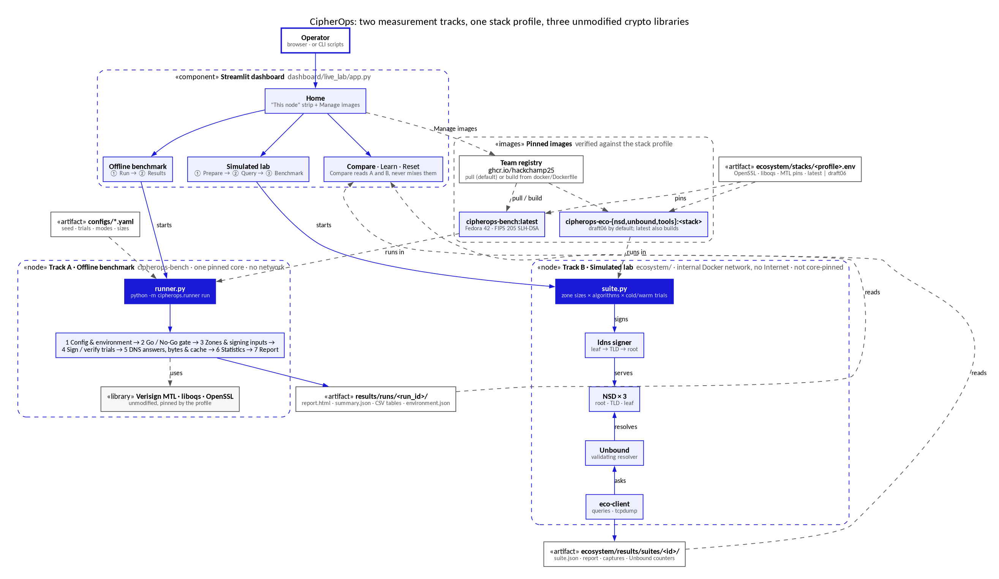

<div align="center">
  <picture>
    <source media="(prefers-color-scheme: dark)" srcset="docs/media/cipherops-logo-dark.png">
    
  </picture>

  # CipherOps

  **PQC DNSSEC MTL benchmark using a reference implementation**

  AIORI Hackathon 3 · PS-036 · Team **A3-PS036-TC161**

  <p>
    <a href="https://codespaces.new/aiori-hackathon/A3-PS036-TC161"></a>
    <a href="https://drive.google.com/file/d/1025mrm1UuBOhKuyuvE1sQzOqRZOkVMDG/view"></a>
    <a href="https://youtu.be/FaVfeO5WTV8"></a>
  </p>
</div>

Post-quantum DNSSEC signatures are large, so signed answers stop fitting in one UDP packet.
**Merkle Tree Ladder (MTL) mode** signs a zone once and gives each record a short proof instead.
CipherOps measures what that changes, against classical DNSSEC and against plain SLH-DSA, using the
[Verisign MTL](https://github.com/verisign/MTL) reference stack unmodified. It adds no cryptography of its own.

> **New to DNSSEC, post-quantum signatures or MTL?** Start with [Learn](docs/learn/README.md): three short animated
> walkthroughs and where the IETF drafts stand.

## For the panel

| | |
| :--- | :--- |
| **Solution proposed** | [Revised, 31 Oct 2026](hackathon/presentation/A3-PS036-TC161_2026-10-31.pdf) · [Level 1, 13 Oct 2026](hackathon/presentation/A3-PS036-TC161_2026-10-13.pdf) |
| **Project video** | [Team Intro - level 1](https://youtu.be/FaVfeO5WTV8) |
| **Submission** | [Deliverables and open items](DELIVERABLES.md) · [readout](hackathon/readout.md) · [findings](hackathon/feedback.md) · [frozen results](hackathon/results/README.md) |

Numbers live in each run's `report.html` (frozen runs are in [hackathon/results](hackathon/results/README.md)), not in
the documentation, so they cannot go stale.

## What it measures

Five algorithms on zones of 50, 500 and 5,000 names: `slh-dsa-mtl` (SLH-DSA-SHA2-128s in MTL mode,
[Verisign MTL](https://github.com/verisign/MTL)), `slh-dsa` (the same algorithm directly, liboqs) and the classical
`ed25519`, `ecdsa-p256` and `rsa-2048` (OpenSSL). For each: signing time, verification time, signature and response
size, truncation, cache use and the cost of updating a zone.

Two tracks answer different questions and are never drawn on one chart:

| Track | What it is | Steps in the dashboard |
| --- | --- | --- |
| **Offline benchmark** | a C harness on one pinned core, no network: crypto cost and exact message sizes | ① Run → ② Results |
| **Simulated lab** | root, TLD and leaf NSD servers behind a validating Unbound, with packet capture: what a resolver sees | ① Prepare → ② Query → ③ Benchmark |



## Run it

You need Docker with Compose v2 and git. The first image build compiles OpenSSL, liboqs and MTL (tens of minutes);
the dashboard can pull ready-made images instead (**Manage images** on its Home page).

| Where | When to use it | How |
| --- | --- | --- |
| **AWS** | the full 5-hour run, or any timing you want to report | below, and [deploy/aws](deploy/aws/README.md) |
| **Local machine** | development, or the quick run | below, and [Getting started](docs/getting-started.md) |
| **Codespaces** | trying it with nothing installed | [Codespaces](docs/codespaces.md) |

**On AWS** (needs the AWS CLI and the Session Manager plugin; about 15 minutes to deploy, no port is opened):

```bash
aws cloudformation deploy --region ap-south-1 --stack-name cipherops \
  --template-file deploy/aws/cipherops-node.yaml --capabilities CAPABILITY_IAM
aws cloudformation describe-stacks --region ap-south-1 --stack-name cipherops \
  --query "Stacks[0].Outputs[?OutputKey=='DashboardTunnel'].OutputValue" --output text   # run what it prints, then open http://localhost:8501
aws cloudformation delete-stack --region ap-south-1 --stack-name cipherops              # when you are done: it bills by the hour
```

The node pulls the pinned images from `ghcr.io/hackchamp25`, so both tracks are ready on arrival. To let a teammate in
with their own AWS login, see [ACCESS.md](deploy/aws/ACCESS.md); for the full run and freezing its result, see
[results](hackathon/results/README.md#still-to-freeze).

**Locally:**

```bash
git clone https://github.com/aiori-hackathon/A3-PS036-TC161.git && cd A3-PS036-TC161
pip install -r requirements-dashboard.txt                 # Python 3.11+
streamlit run dashboard/live_lab/app.py                   # the dashboard
bash scripts/run_benchmark.sh configs/quick.yaml          # or a short offline run from the shell
```

[Dashboard guide](dashboard/live_lab/README.md) · [Scope and limits](docs/scope-and-limits.md) · all documents:
[docs/README.md](docs/README.md)

## Team and license

**A3-PS036-TC161**: Akash Joshi · Anitha Natarajan · Indu Radhakrishnan (faculty). MIT, see [LICENSE](LICENSE). Verisign
MTL, liboqs, OpenSSL, NSD and the rest keep their own licences and are built at pinned versions, never copied here: see
[third-party notices](THIRD_PARTY_NOTICES.md). CipherOps is not affiliated with or endorsed by Verisign. To cite it, see
[CITATION.cff](CITATION.cff).
