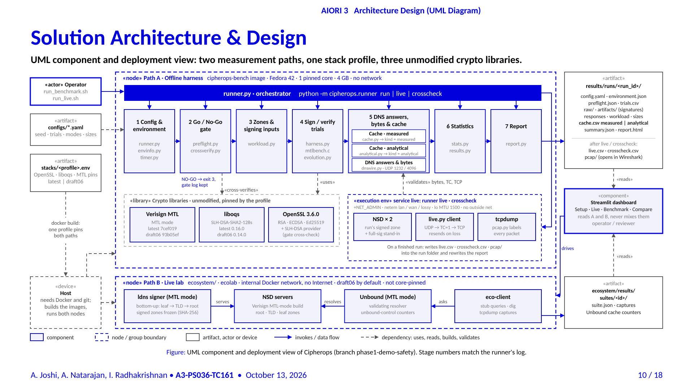

<div align="center">
  <picture>
    <source media="(prefers-color-scheme: dark)" srcset="docs/media/cipherops-logo-dark.png">
    
  </picture>

  # CipherOps

  **PQC DNSSEC MTL benchmark using a reference implementation**

  AIORI Hackathon 3 · PS-036 · Team **A3-PS036-TC161**

  <p>
    <a href="https://codespaces.new/aiori-hackathon/A3-PS036-TC161"></a>
    <a href="https://drive.google.com/file/d/1025mrm1UuBOhKuyuvE1sQzOqRZOkVMDG/view"></a>
    <a href="https://youtu.be/FaVfeO5WTV8"></a>
  </p>
</div>

Post-quantum DNSSEC signatures are large, so signed answers stop fitting in one UDP packet.
**Merkle Tree Ladder (MTL) mode** signs a zone once and gives each record a short proof instead.
CipherOps measures what that changes, against classical DNSSEC and against plain SLH-DSA, using the
[Verisign MTL](https://github.com/verisign/MTL) reference stack unmodified. It adds no cryptography of its own.

> **New to DNSSEC, post-quantum signatures or MTL?** Start with [Learn](docs/learn/README.md): two short animated
> walkthroughs and where the IETF drafts stand.

## For the panel

| | |
| :--- | :--- |
| **Solution proposed** | [Revised, 30 Oct 2026](hackathon/presentation/A3-PS036-TC161_2026-10-30.pdf) · [Level 1, 13 Oct 2026](hackathon/presentation/A3-PS036-TC161_2026-10-13.pdf) |
| **Project video** | [Team Intro - level 1](https://youtu.be/FaVfeO5WTV8). [Solution Demo]() |
| **Working demo** | [Run it in your browser with Codespaces](docs/codespaces.md), or [locally](docs/getting-started.md) |
| **Submission** | [Deliverables](DELIVERABLES.md) · [project page and readout](hackathon/README.md) · [frozen results](hackathon/results/README.md) |
| **How we measure** | [Methodology](docs/methodology.md) · [Architecture](docs/architecture.md) |

Numbers live in each run's `report.html` (a frozen run is in [hackathon/results](hackathon/results/README.md)), not in the documentation, so they cannot go stale.

## What it measures

| Mode | Algorithm | Library |
| --- | --- | --- |
| `slh-dsa-mtl` | SLH-DSA-SHA2-128s in MTL mode | [Verisign MTL](https://github.com/verisign/MTL) |
| `slh-dsa` | SLH-DSA-SHA2-128s directly | liboqs |
| `ed25519`, `ecdsa-p256`, `rsa-2048` | Classical DNSSEC | OpenSSL |

On zones of 50, 500 and 5,000 names: signing time, verification time, signature and response size, truncation, cache
use, and the cost of updating a zone. Two paths answer different questions: an **offline harness** (one pinned core,
no network) and a **simulated lab** (root, TLD and leaf NSD servers behind a validating Unbound, with packet capture).



## Quick start

**Locally** you need Docker, git and Python 3.11+:

```bash
git clone https://github.com/aiori-hackathon/A3-PS036-TC161.git && cd A3-PS036-TC161
pip install -r requirements-dashboard.txt
streamlit run dashboard/live_lab/app.py          # the dashboard
bash scripts/run_benchmark.sh configs/quick.yaml  # or: a short offline run from the shell
```

**In Codespaces** the repository is already cloned and the dashboard requirements are installed by the dev container,
so just run:

```bash
python -m streamlit run dashboard/live_lab/app.py --server.port 8501   # then open the forwarded port 8501
bash scripts/run_benchmark.sh configs/quick.yaml                       # or: a short offline run from the shell
```

**Codespaces machine size.** Observed: the free 4-core / 16 GB / 32 GB machine runs the **offline harness**
but not the **simulated lab** (about 7 containers on cores 2-5); the lab needs the paid 8-core / 32 GB / 64 GB machine.
See [Codespaces](docs/codespaces.md#which-machine-for-what).

The first image build compiles OpenSSL, liboqs and MTL from source and takes a while; later runs reuse it. Full
instructions, Windows commands, tests and troubleshooting: [Getting started](docs/getting-started.md).

## The dashboard

The dashboard opens on the two ways of benchmarking. Each is a short numbered path:

| Track | Question it answers | Steps |
| --- | --- | --- |
| **Offline benchmark** | How fast is each algorithm? One pinned core, no network. | ① Image → ② Run → ③ Results |
| **Simulated lab** | How does a real resolver behave? Real servers, packets and cache. | ① Images → ② Prepare lab → ③ Query lab → ④ Benchmark |

Below them: **Compare** (algorithms side by side, run against run, zone-update cost), **Learn** (why DNSSEC needs MTL),
**Images** (both image sets in one place) and **Reset** (clear only what you choose).

Details: [dashboard guide](dashboard/live_lab/README.md).

## Scope

Empirical timings and wire sizes on pinned stacks; not a security proof and not a production DNSSEC product. Offline
and simulated results use different library versions and are never mixed; simulated timings are indicative, not
core-pinned; the MTL drafts are not RFCs yet. Full list and software stacks:
[Scope and limits](docs/scope-and-limits.md).

## Documentation

The full index is [docs/README.md](docs/README.md).

| | |
| --- | --- |
| **Use** | [Getting started](docs/getting-started.md) · [Codespaces](docs/codespaces.md) · [Dashboard guide](dashboard/live_lab/README.md) |
| **Understand** | [Learn](docs/learn/README.md) · [Scope and limits](docs/scope-and-limits.md) · [Design decisions](docs/design-decisions.md) |
| **Check** | [Methodology](docs/methodology.md) · [Architecture](docs/architecture.md) · [End-to-end flow](docs/end-to-end-flow.md) · [Outputs reference](docs/outputs-reference.md) |

## Team and license

**A3-PS036-TC161**: Akash Joshi · Anitha Natarajan · Indu Radhakrishnan (faculty). MIT, see [LICENSE](LICENSE). Verisign
MTL, liboqs, OpenSSL, NSD and the rest keep their own licences and are built at pinned versions, never copied here: see
[third-party notices](THIRD_PARTY_NOTICES.md). CipherOps is not affiliated with or endorsed by Verisign. To cite it, see
[CITATION.cff](CITATION.cff).
