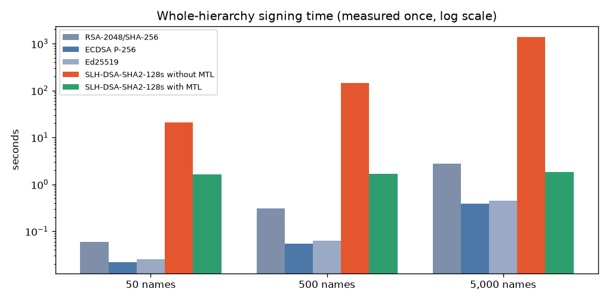
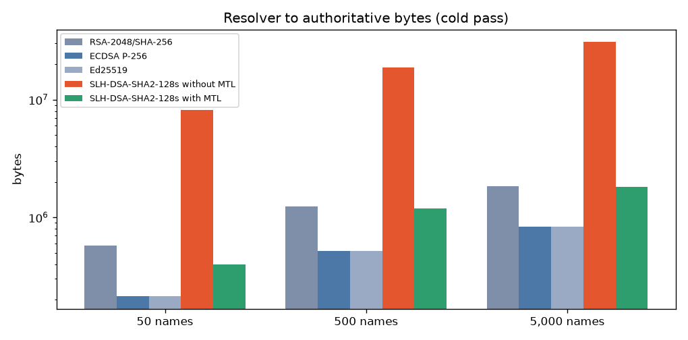
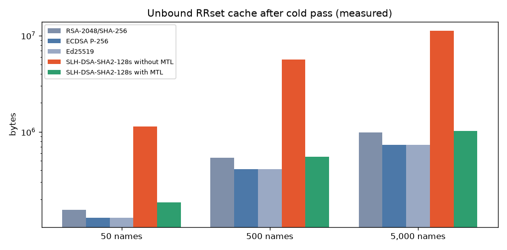
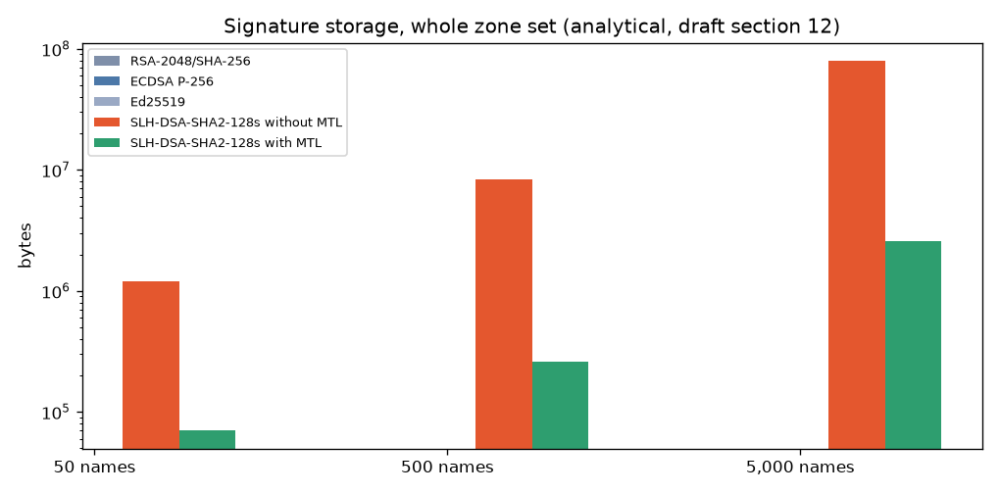

# DNS Lab Benchmark: MTL Mode for Post-Quantum DNSSEC
### PS-036 · Real hierarchy (NSD + Unbound + ldns) · Cipherops ecosystem

Suite `20261031-052353_ec2-ps036-sim-50-500-5000-loss` · stack **draft06** · 5 measurement trials · 5 signing trials · 2000 lookups per pass · finished `20261031-071428` · wall 110.6 min

## Abstract

Post-quantum signatures such as SLH-DSA-SHA2-128s are large enough that DNSSEC answers often no longer fit a 1232-byte UDP buffer. Merkle Tree Ladder (MTL) mode signs a zone with one PQC signature over a Merkle ladder and attaches a short authentication path to each RRset. This report is the **real-DNS** counterpart to the main Cipherops library report: a multi-zone hierarchy is signed with ldns, served by Verisign MTL-mode NSD, validated by Unbound, and measured with repeated cold/warm trials and packet captures.

This suite used stack **draft06** (MTL `93b05ef73dab…`, liboqs 0.14.0). On draft06, MTL answers are **condensed by default**; a full signed ladder is returned when the resolver asks with EDNS option 65050.

**Provenance in this report.** Signing and verification times appear as **Measured once** (full zones that were served) and, where sample trials exist, as **Estimated** (extrapolated from repeated sample-zone trials, with a distribution-free CI of the median). Wire bytes and Unbound cache are **Measured** from the lab. Signature-storage totals tagged **Analytical** use draft-harvey-cfrg-mtl-mode section 12 formulas only.

**Key results** (MTL vs SLH-DSA-SHA2-128s without MTL):

- **Signing (medium, 500 names, measured once).** MTL 1.7 s; direct SLH-DSA 2.4 min (86× faster).
- **Signing (medium, estimated from sample trials).** MTL 1.7 s; direct SLH-DSA 2.4 min (86× faster).
- **Zone verification (medium, `ldns-verify-zone`, measured once).** MTL 67 ms; direct SLH-DSA 498 ms (7.4× faster).
- **Transmitted bytes (medium, cold upstream, measured).** MTL 1.13 MB; direct SLH-DSA 17.97 MB (16× less data).
- **Resolver RRset cache (medium, measured).** MTL 536.1 KB; direct SLH-DSA 5.37 MB (10× less memory).
- **Signing (large, 5,000 names, measured once).** MTL 1.8 s; direct SLH-DSA 22.7 min (743× faster).
- **Signing (large, estimated from sample trials).** MTL 1.9 s; direct SLH-DSA 22.6 min (713× faster).
- **Zone verification (large, `ldns-verify-zone`, measured once).** MTL 496 ms; direct SLH-DSA 4.6 s (9.3× faster).
- **Transmitted bytes (large, cold upstream, measured).** MTL 1.72 MB; direct SLH-DSA 29.35 MB (17× less data).
- **Resolver RRset cache (large, measured).** MTL 1003.4 KB; direct SLH-DSA 10.65 MB (11× less memory).

## 1. Problem statement

PS-036 asks for a reproducible measurement of what MTL mode changes for DNSSEC when the same PQC algorithm is used with and without MTL, on three dataset sizes, under a pinned environment, reporting signing time, verification time and transmitted bytes, with cache use kept separate from analytical estimates. This suite answers that on a **live multi-zone DNS path**, complementary to the in-process library harness.

## 2. Background

- **DNSSEC** (RFC 4033–4035) signs each RRset; NSEC3 proves non-existence.
- **SLH-DSA-SHA2-128s** (FIPS 205): 32-byte public key, 7,856-byte signature.
- **MTL mode** (draft-harvey-cfrg-mtl-mode): one signed ladder per series; condensed paths per message; full signature = condensed + signed ladder.
- **DNSSEC MTL (draft-fregly-06 / this stack):** condensed RRSIGs by default on draft06; full ladder on EDNS 65050. Always-full wire behaviour is a different stack (`latest`).

## 3. Objectives and scope

Compare equivalent DNSSEC workloads with and without MTL on three dataset sizes in a Docker hierarchy. Measure signing, offline zone verification, resolver wire bytes and Unbound cache. Report analytical signature-storage sizes separately. Out of scope: new cryptography, Internet deployment, security proofs.

| PS-036 / expected outcome | How this suite meets it | Where |
|---|---|---|
| One supported PQC signature algorithm | SLH-DSA-SHA2-128s in ``slh-dsa`` and ``mtl`` scenarios | sec. 4.3 |
| One mentor-tested MTL reference implementation | Verisign MTL / mtl-mode-nsd / unbound / ldns at stack pin | sec. 4.1 |
| Three dataset sizes | 50 / 500 / 5,000 data names across a fixed hierarchy | sec. 4.2 |
| Equivalent workloads with and without MTL | Same zones, same seeded lookup list per size | sec. 4.4 |
| Repeated trials, pinned software and hardware | Measurement trials + signing trials; stack images; host snapshot | sec. 4.1, 4.4 |
| Signing time | Full-zone wall clock once; sample trials extrapolated with 95% CI | sec. 5.1 |
| Verification time | ``ldns-verify-zone`` wall clock (offline; not Unbound validation) | sec. 5.2 |
| Transmitted bytes | Resolver to authoritative bytes from Unbound-iface pcap, cold pass | sec. 5.3 |
| Record configuration and workload parameters | ``params.json`` / ``suite.json`` / per-run ``run.json`` | Appendix A |
| Separate measured cache from analytical estimates | Unbound cache memory vs draft section 12 signature storage | sec. 5.4 |
| Reproducible results report | This `report.md` / `report.html`, regenerated from suite artifacts | this document |
| Technical demonstration | Dashboard Simulated lab (Prepare, Query, Benchmark) + Compare over the same stack | dashboard |

## 4. Methodology

### 4.1 Pinned environment

| Item | Value |
|---|---|
| Suite id | 20261031-052353_ec2-ps036-sim-50-500-5000-loss |
| Stack | draft06 |
| Host platform | Linux-6.18.56-125.164.amzn2023.x86_64-x86_64-with-glibc2.34 |
| Host CPUs | 8 |
| Host Python | 3.9.25 |
| CPU model | Intel(R) Xeon(R) Platinum 8488C |
| Memory | MemTotal:       32313712 kB |
| Kernel | 6.18.56-125.164.amzn2023.x86_64 |
| CPU frequency governor | unavailable |
| CPU isolation | none (lab containers share all host CPUs) |
| Docker server | 25.0.18 |
| Code version (git) | f12bb437582c (uncommitted changes) |
| Signature primitive | SPHINCS+-SHA2-128s-simple (pre-standard form of SLH-DSA, liboqs 0.14), in ldns, MTL and Unbound |
| liboqs (stack) | 0.14.0 |
| MTL commit (stack) | 93b05ef73dab53b953cc4e262401a2ce9bc9e431 |
| ldns commit (stack) | 64906672ae0d80ae03933240daab27e19ceccf70 |
| NSD commit (stack) | 09ebb4e551b5029f7ddf7e381b7bb8a966fa1320 |
| Unbound commit (stack) | fab43ad682301633fa119158ecd22924f042cb26 |
| Parallel signing jobs | 1 |
| UDP size limit | 1232 |
| Networks | lossy |

Images used (from `docker image inspect` at the start of the suite):

- `cipherops-bench:draft06` = `unavailable` (built )
- `cipherops-eco-nsd:draft06` = `sha256:d37b860c8023b780b1da374f06a638db687fe7a151eceefc60cd3be93e558b54` (built 2026-10-31T02:52:45.147179165Z)
- `cipherops-eco-unbound:draft06` = `sha256:8b0d032387d16c98019dc53bab83f22c9b669b596f2dd7465bbb83a8559d34d6` (built 2026-10-31T02:52:54.134066069Z)
- `cipherops-eco-tools:draft06` = `sha256:c56784b90b4863f238bba9943962ea3330cf7a923028f7e2dcfc0a07dd7db637` (built 2026-10-31T02:53:15.1506676Z)

Image digests recorded in per-size `run.json`:

- `root = {'image': 'cipherops-eco-nsd:draft06', 'image_id': 'sha256:d37b860c8023b780b1da374f06a638db687fe7a151eceefc60cd3be93e558b54'}`
- `tld-test = {'image': 'cipherops-eco-nsd:draft06', 'image_id': 'sha256:d37b860c8023b780b1da374f06a638db687fe7a151eceefc60cd3be93e558b54'}`
- `sld1 = {'image': 'cipherops-eco-nsd:draft06', 'image_id': 'sha256:d37b860c8023b780b1da374f06a638db687fe7a151eceefc60cd3be93e558b54'}`
- `unbound = {'image': 'cipherops-eco-unbound:draft06', 'image_id': 'sha256:8b0d032387d16c98019dc53bab83f22c9b669b596f2dd7465bbb83a8559d34d6'}`
- `client = {'image': 'cipherops-eco-tools:draft06', 'image_id': 'sha256:c56784b90b4863f238bba9943962ea3330cf7a923028f7e2dcfc0a07dd7db637'}`

### 4.2 Datasets and hierarchy

Each dataset size uses the same shape: one root, one TLD (`test.`), up to four leaf zones on one leaf server. Only the number of data names changes; names are split across the leaf zones. This is **not** a single zone of N names (that is the main library harness).

| dataset (names) | leaf zones | names per leaf | zones total | lab tag | run folder |
|---|---|---|---|---|---|
| 50 | 4 | 13, 13, 12, 12 | 6 | eco-bench-50-draft06 | 20261031-052355_ec2-ps036-sim-50-500-5000-loss-n50 |
| 500 | 4 | 125, 125, 125, 125 | 6 | eco-bench-500-draft06 | 20261031-054246_ec2-ps036-sim-50-500-5000-loss-n500 |
| 5,000 | 4 | 1250, 1250, 1250, 1250 | 6 | eco-bench-5000-draft06 | 20261031-061911_ec2-ps036-sim-50-500-5000-loss-n5000 |

*Table 1: datasets.*

### 4.3 Scenarios

| Scenario | Meaning |
|---|---|
| `rsa` | RSA-2048/SHA-256 |
| `ecdsa` | ECDSA P-256 |
| `ed25519` | Ed25519 |
| `slh-dsa` | SLH-DSA-SHA2-128s without MTL |
| `mtl` | SLH-DSA-SHA2-128s with MTL |

### 4.4 Measurement procedure

- For each dataset size the suite signs every zone once per scenario (**Measured once**), with `jobs=1`.
- It then repeats signing and `ldns-verify-zone` on sample leaf zones (5 trials; sample sizes derived from `sample_names=100`). A two-point fit (fixed cost per zone + cost per RRSIG) extrapolates to the full hierarchy (**Estimated**, CI of the median).
- The lab is started; the seeded workload (2000 lookups, nx_fraction=0.1, name Zipf s=1.1, zone Zipf s=1.0) is replayed for 5 trials, each with a cold pass (resolver restarted) and a warm pass.
- Upstream bytes and truncations come from pcap on the Unbound interface; cache figures from `unbound-control` memory stats after the cold pass.
- The lab is stopped before the next dataset size.

### 4.5 What is not claimed

- **Verification** in the tables is offline `ldns-verify-zone` over signed zone files, not Unbound’s per-query validation cost (that sits inside cold/warm lookup latency).
- **Estimated** signing/verify must not be read as the wall-clock of the served zones; use **Measured once** for that.
- Absolute seconds are not comparable to the main library report (different topology and tool). Compare **MTL ÷ SLH-DSA ratios** per size.
- Stack draft06 condensed-by-default wire semantics differ from the always-full `latest` stack and from the main library’s MTL commit when they diverge.

## 5. Results

### 5.1 Signing time



*Figure 1: whole-hierarchy signing time (measured once, log scale)*

| dataset | scenario | zones | RRSIGs | sign estimated [95% CI] | sign measured once | signed size |
|---|---|---|---|---|---|---|
| 50 | ECDSA P-256 | 6 | 153 | 23 ms [23 ms–23 ms] | 22 ms | 52.1 KB |
| 50 | Ed25519 | 6 | 153 | 23 ms [23 ms–23 ms] | 25 ms | 51.8 KB |
| 50 | SLH-DSA-SHA2-128s with MTL | 6 | 153 | 1.6 s [395 ms–1.6 s] | 1.6 s | 191.5 KB |
| 50 | RSA-2048/SHA-256 | 6 | 153 | 57 ms [56 ms–63 ms] | 59 ms | 91.7 KB |
| 50 | SLH-DSA-SHA2-128s without MTL | 6 | 153 | 20.8 s [20.8 s–20.8 s] | 20.7 s | 1.57 MB |
| 500 | ECDSA P-256 | 6 | 1053 | 58 ms [58 ms–58 ms] | 55 ms | 397.0 KB |
| 500 | Ed25519 | 6 | 1053 | 63 ms [63 ms–64 ms] | 62 ms | 396.5 KB |
| 500 | SLH-DSA-SHA2-128s with MTL | 6 | 1053 | 1.7 s [1.7 s–1.7 s] | 1.7 s | 712.0 KB |
| 500 | RSA-2048/SHA-256 | 6 | 1053 | 308 ms [308 ms–308 ms] | 308 ms | 660.4 KB |
| 500 | SLH-DSA-SHA2-128s without MTL | 6 | 1053 | 2.4 min [2.4 min–2.4 min] | 2.4 min | 10.82 MB |
| 5,000 | ECDSA P-256 | 6 | 10053 | 418 ms [354 ms–418 ms] | 390 ms | 3.64 MB |
| 5,000 | Ed25519 | 6 | 10053 | 483 ms [424 ms–483 ms] | 443 ms | 3.64 MB |
| 5,000 | SLH-DSA-SHA2-128s with MTL | 6 | 10053 | 1.9 s [1.8 s–1.9 s] | 1.8 s | 6.04 MB |
| 5,000 | RSA-2048/SHA-256 | 6 | 10053 | 2.8 s [2.8 s–2.8 s] | 2.8 s | 6.09 MB |
| 5,000 | SLH-DSA-SHA2-128s without MTL | 6 | 10053 | 22.6 min [22.5 min–22.7 min] | 22.7 min | 103.24 MB |

*Table 2: signing time. Estimated = sample-trial extrapolation; measured once = full zones served.*

### 5.2 Zone verification time (`ldns-verify-zone`)

| dataset | scenario | verify estimated [95% CI] | verify measured once |
|---|---|---|---|
| 50 | ECDSA P-256 | 27 ms [27 ms–27 ms] | 29 ms |
| 50 | Ed25519 | 33 ms [33 ms–33 ms] | 31 ms |
| 50 | SLH-DSA-SHA2-128s with MTL | 28 ms [28 ms–28 ms] | 28 ms |
| 50 | RSA-2048/SHA-256 | 22 ms [22 ms–22 ms] | 22 ms |
| 50 | SLH-DSA-SHA2-128s without MTL | 87 ms [87 ms–87 ms] | 87 ms |
| 500 | ECDSA P-256 | 119 ms [114 ms–119 ms] | 115 ms |
| 500 | Ed25519 | 135 ms [135 ms–135 ms] | 132 ms |
| 500 | SLH-DSA-SHA2-128s with MTL | 75 ms [75 ms–80 ms] | 67 ms |
| 500 | RSA-2048/SHA-256 | 68 ms [68 ms–68 ms] | 66 ms |
| 500 | SLH-DSA-SHA2-128s without MTL | 496 ms [496 ms–501 ms] | 498 ms |
| 5,000 | ECDSA P-256 | 954 ms [954 ms–954 ms] | 995 ms |
| 5,000 | Ed25519 | 1.2 s [1.1 s–1.2 s] | 1.2 s |
| 5,000 | SLH-DSA-SHA2-128s with MTL | 495 ms [430 ms–495 ms] | 496 ms |
| 5,000 | RSA-2048/SHA-256 | 548 ms [548 ms–548 ms] | 536 ms |
| 5,000 | SLH-DSA-SHA2-128s without MTL | 4.6 s [4.6 s–4.6 s] | 4.6 s |

*Table 3: offline zone verification. Not Unbound validation latency.*

### 5.3 Transmitted bytes



*Figure 2: resolver to authoritative bytes on the cold pass (log scale)*

| dataset | scenario | upstream bytes (cold) | upstream queries | truncated | TCP conns | cold median (ms) | warm median (ms) |
|---|---|---|---|---|---|---|---|
| 50 | ECDSA P-256 | 209.9 KB | 316 | 5 | 1 | 2.60 | 2.54 |
| 50 | Ed25519 | 209.3 KB | 316 | 5 | 1 | 2.60 | 2.54 |
| 50 | SLH-DSA-SHA2-128s with MTL | 388.7 KB | 343 | 18 | 3 | 2.60 | 2.54 |
| 50 | RSA-2048/SHA-256 | 561.1 KB | 448 | 136 | 1 | 2.61 | 2.55 |
| 50 | SLH-DSA-SHA2-128s without MTL | 7.76 MB | 624 | 312 | 3 | 2.62 | 2.54 |
| 500 | ECDSA P-256 | 503.6 KB | 829 | 36 | 1 | 2.64 | 2.54 |
| 500 | Ed25519 | 503.7 KB | 829 | 36 | 1 | 2.64 | 2.54 |
| 500 | SLH-DSA-SHA2-128s with MTL | 1.13 MB | 1070 | 260 | 3 | 2.64 | 2.54 |
| 500 | RSA-2048/SHA-256 | 1.17 MB | 1042 | 250 | 1 | 2.64 | 2.54 |
| 500 | SLH-DSA-SHA2-128s without MTL | 17.97 MB | 1584 | 792 | 3 | 2.65 | 2.54 |
| 5,000 | ECDSA P-256 | 817.6 KB | 1433 | 64 | 1 | 2.75 | 2.54 |
| 5,000 | Ed25519 | 817.7 KB | 1432 | 65 | 1 | 2.75 | 2.54 |
| 5,000 | SLH-DSA-SHA2-128s with MTL | 1.72 MB | 1678 | 295 | 3 | 2.76 | 2.54 |
| 5,000 | RSA-2048/SHA-256 | 1.76 MB | 1653 | 284 | 1 | 2.75 | 2.54 |
| 5,000 | SLH-DSA-SHA2-128s without MTL | 29.35 MB | 2732 | 1366 | 3 | 2.77 | 2.54 |

*Table 4: wire and lookup latency from the lab (measured).*

### 5.4 Cache use (measured) and analytical signature storage



*Figure 3: Unbound RRset cache after the cold pass (measured)*



*Figure 4: analytical whole-zone signature storage (draft section 12); not measured cache*

| dataset | scenario | RRset cache (measured) | message cache (measured) | signature storage (analytical) | signed zone files (measured) |
|---|---|---|---|---|---|
| 50 | ECDSA P-256 | 125.7 KB | 153.7 KB | — | 52.1 KB |
| 50 | Ed25519 | 125.6 KB | 153.7 KB | — | 51.8 KB |
| 50 | SLH-DSA-SHA2-128s with MTL | 182.0 KB | 153.7 KB | 68.9 KB | 191.5 KB |
| 50 | RSA-2048/SHA-256 | 151.3 KB | 153.7 KB | — | 91.7 KB |
| 50 | SLH-DSA-SHA2-128s without MTL | 1.09 MB | 153.7 KB | 1.15 MB | 1.57 MB |
| 500 | ECDSA P-256 | 398.8 KB | 244.6 KB | — | 397.0 KB |
| 500 | Ed25519 | 398.6 KB | 244.6 KB | — | 396.5 KB |
| 500 | SLH-DSA-SHA2-128s with MTL | 536.1 KB | 244.6 KB | 255.7 KB | 712.0 KB |
| 500 | RSA-2048/SHA-256 | 525.4 KB | 244.6 KB | — | 660.4 KB |
| 500 | SLH-DSA-SHA2-128s without MTL | 5.37 MB | 244.6 KB | 7.89 MB | 10.82 MB |
| 5,000 | ECDSA P-256 | 717.2 KB | 347.4 KB | — | 3.64 MB |
| 5,000 | Ed25519 | 717.0 KB | 347.4 KB | — | 3.64 MB |
| 5,000 | SLH-DSA-SHA2-128s with MTL | 1003.4 KB | 347.6 KB | 2.46 MB | 6.04 MB |
| 5,000 | RSA-2048/SHA-256 | 969.4 KB | 347.6 KB | — | 6.09 MB |
| 5,000 | SLH-DSA-SHA2-128s without MTL | 10.65 MB | 347.6 KB | 75.32 MB | 103.24 MB |

*Table 5: measured Unbound cache memory vs analytical signature-material estimate and on-disk signed zone size.*

### 5.5 MTL vs SLH-DSA without MTL (ratios)

Values are **MTL ÷ SLH-DSA** (lower is a larger MTL win). Signing uses **measured once**; bytes and cache are measured.

| dataset | sign (measured once) | verify (measured once) | signed size | upstream bytes | RRset cache | analytical sig storage |
|---|---|---|---|---|---|---|
| 50 | 0.080 | 0.322 | 0.119 | 0.049 | 0.163 | 0.059 |
| 500 | 0.012 | 0.135 | 0.064 | 0.063 | 0.098 | 0.032 |
| 5,000 | 0.001 | 0.107 | 0.059 | 0.059 | 0.092 | 0.033 |

*Table 6: MTL / SLH-DSA ratios.*

## 6. Discussion

Across all three sizes, MTL reduces full-hierarchy signing time and cold upstream bytes relative to direct SLH-DSA on the same names and workload. Wire and cache wins are especially large on draft06 because condensed signatures are the default on the wire. Lookup medians are not uniformly better for MTL; cold latency can be comparable or slightly higher when ladder/path work dominates a short LAN RTT.

Estimated signing from sample trials tracks measured-once MTL closely when `jobs=1`; large direct-SLH-DSA estimates can under- or over-shoot the full wall clock and should be read with the CI and the measured-once column.

## 7. Conclusions

On equivalent real-DNS workloads and the same underlying PQC algorithm, MTL mode in the pinned Verisign stack reduced zone signing time and transmitted bytes versus direct SLH-DSA at 50, 500 and 5,000 names. Cache memory after the cold pass followed the same direction. All headline wire and cache figures are measured; signing is reported both as measured-once and as trial-based estimates; analytical sizes are formula-only. Regenerate this document with `python -m live_lab.suite_report 20261031-052353_ec2-ps036-sim-50-500-5000-loss`.

## Appendix A. Configuration

```json
{
  "label": "ec2-ps036-sim-50-500-5000-loss",
  "stack": "draft06",
  "reuse": "20261031-025321_ec2-ps036-sim-50-500-5000-lan",
  "sizes": [
    50,
    500,
    5000
  ],
  "scenarios": [
    "ecdsa",
    "ed25519",
    "rsa",
    "slh-dsa",
    "mtl"
  ],
  "trials": 5,
  "sign_trials": 5,
  "sample_names": 100,
  "n_queries": 2000,
  "networks": [
    "lossy"
  ],
  "udp": 1232,
  "jobs": 1,
  "workload": {
    "nx_fraction": 0.1,
    "zone_zipf_s": 1.0,
    "name_zipf_s": 1.1,
    "timeout_s": 5.0
  },
  "profiles": {
    "wan": {
      "client_ms": 2,
      "root_ms": 20,
      "tld_ms": 35,
      "sld_ms": 50,
      "loss_pct": 0
    },
    "lossy": {
      "client_ms": 2,
      "root_ms": 20,
      "tld_ms": 35,
      "sld_ms": 50,
      "loss_pct": 1
    }
  },
  "suite_id": "20261031-052353_ec2-ps036-sim-50-500-5000-loss",
  "stamp": "20261031-052353",
  "finished": "20261031-071428",
  "seconds": 6635,
  "sizes_detail": {
    "50": {
      "tag": "eco-bench-50-draft06",
      "run_folder": "20261031-052355_ec2-ps036-sim-50-500-5000-loss-n50",
      "names": 50,
      "zones": 6,
      "config": "configs/_bench-50.yaml"
    },
    "500": {
      "tag": "eco-bench-500-draft06",
      "run_folder": "20261031-054246_ec2-ps036-sim-50-500-5000-loss-n500",
      "names": 500,
      "zones": 6,
      "config": "configs/_bench-500.yaml"
    },
    "5000": {
      "tag": "eco-bench-5000-draft06",
      "run_folder": "20261031-061911_ec2-ps036-sim-50-500-5000-loss-n5000",
      "names": 5000,
      "zones": 6,
      "config": "configs/_bench-5000.yaml"
    }
  },
  "host": {
    "platform": "Linux-6.18.56-125.164.amzn2023.x86_64-x86_64-with-glibc2.34",
    "cpus": 8,
    "python": "3.9.25"
  },
  "provenance": {
    "git_commit": "f12bb437582ce7816a5da9b3ed998d57f197f131",
    "git_dirty": true,
    "platform": "Linux-6.18.56-125.164.amzn2023.x86_64-x86_64-with-glibc2.34",
    "kernel": "6.18.56-125.164.amzn2023.x86_64",
    "cpu_model": "Intel(R) Xeon(R) Platinum 8488C",
    "cpus": 8,
    "mem_total": "MemTotal:       32313712 kB",
    "cpu_governor": "unavailable",
    "python": "3.9.25",
    "docker_server": "25.0.18",
    "stack": "draft06",
    "stack_pins": {
      "STACK": "draft06",
      "OPENSSL_TAG": "openssl-3.6.0",
      "LIBOQS_TAG": "0.14.0",
      "MTL_COMMIT": "93b05ef73dab53b953cc4e262401a2ce9bc9e431",
      "LDNS_COMMIT": "64906672ae0d80ae03933240daab27e19ceccf70",
      "NSD_COMMIT": "09ebb4e551b5029f7ddf7e381b7bb8a966fa1320",
      "UNBOUND_COMMIT": "fab43ad682301633fa119158ecd22924f042cb26"
    },
    "images": {
      "cipherops-bench": {
        "id": "unavailable",
        "created": ""
      },
      "cipherops-eco-nsd": {
        "id": "sha256:d37b860c8023b780b1da374f06a638db687fe7a151eceefc60cd3be93e558b54",
        "created": "2026-10-31T02:52:45.147179165Z"
      },
      "cipherops-eco-unbound": {
        "id": "sha256:8b0d032387d16c98019dc53bab83f22c9b669b596f2dd7465bbb83a8559d34d6",
        "created": "2026-10-31T02:52:54.134066069Z"
      },
      "cipherops-eco-tools": {
        "id": "sha256:c56784b90b4863f238bba9943962ea3330cf7a923028f7e2dcfc0a07dd7db637",
        "created": "2026-10-31T02:53:15.1506676Z"
      }
    },
    "cpu_isolation": "none (lab containers share all host CPUs)"
  }
}
```

## Appendix B. Artifacts

- Suite directory: `ecosystem/results/suites/20261031-052353_ec2-ps036-sim-50-500-5000-loss/`
- `suite.json`, `params.json`, `signing_full.csv`, `signing_trials_*.csv`
- `report.md`, `report.html`, `figures/` (this report)
- 50 names: `ecosystem/results/eco-bench-50-draft06/20261031-052355_ec2-ps036-sim-50-500-5000-loss-n50/` (summary.csv, run.json, passes.csv, hops.csv, pcap/)
- 500 names: `ecosystem/results/eco-bench-500-draft06/20261031-054246_ec2-ps036-sim-50-500-5000-loss-n500/` (summary.csv, run.json, passes.csv, hops.csv, pcap/)
- 5000 names: `ecosystem/results/eco-bench-5000-draft06/20261031-061911_ec2-ps036-sim-50-500-5000-loss-n5000/` (summary.csv, run.json, passes.csv, hops.csv, pcap/)

## References

1. draft-harvey-cfrg-mtl-mode-09, *Merkle Tree Ladder (MTL) Mode Signatures*.
2. draft-fregly-dnsop-slh-dsa-mtl-dnssec, *SLH-DSA-MTL in DNSSEC*.
3. FIPS 205, *Stateless Hash-Based Digital Signature Standard*.
4. RFC 4033–4035 (DNSSEC); RFC 5155 (NSEC3).
5. Verisign MTL reference library, https://github.com/verisign/MTL.
6. Cipherops main library report (companion): `results/runs/<id>/report.html`.

