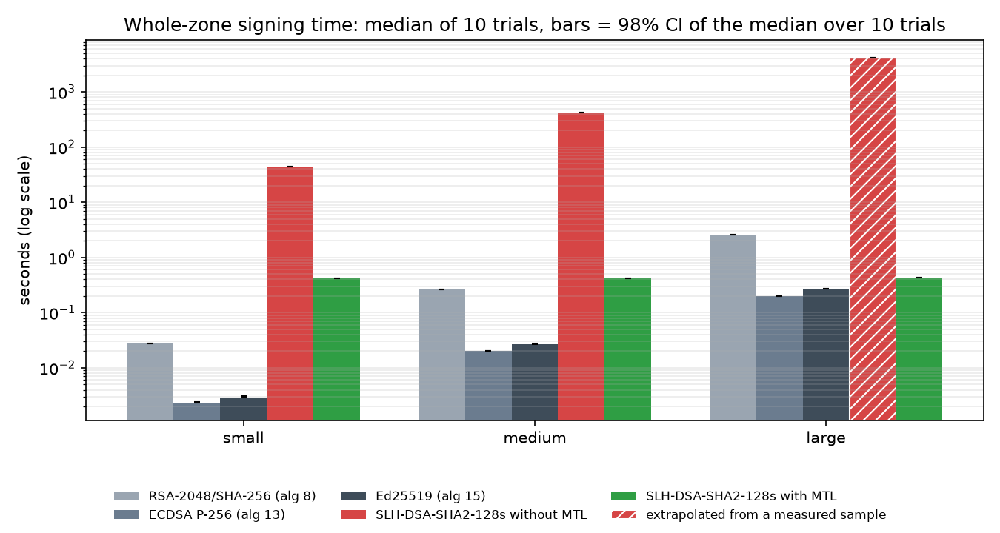
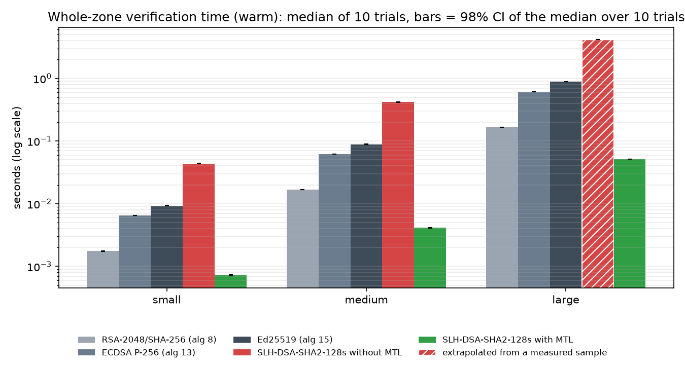
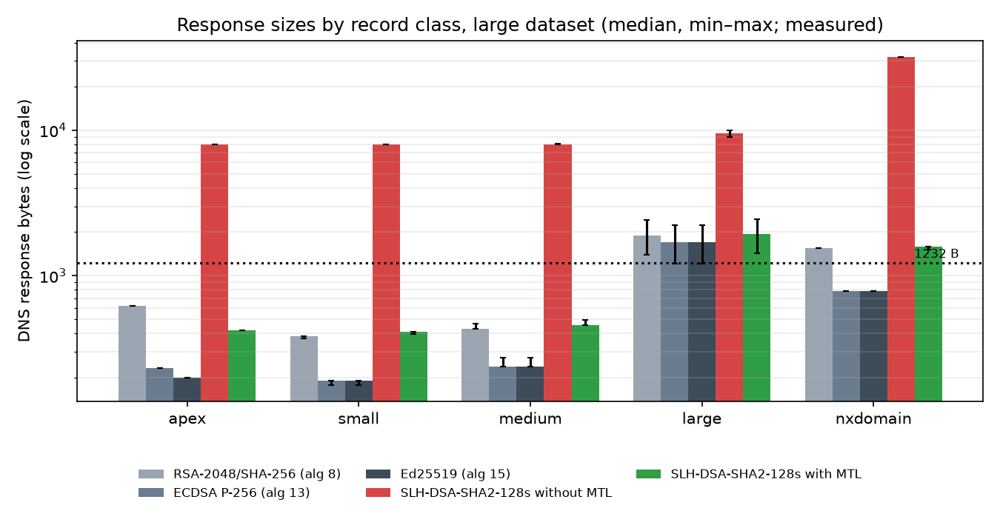
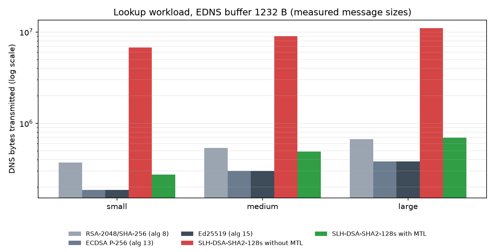
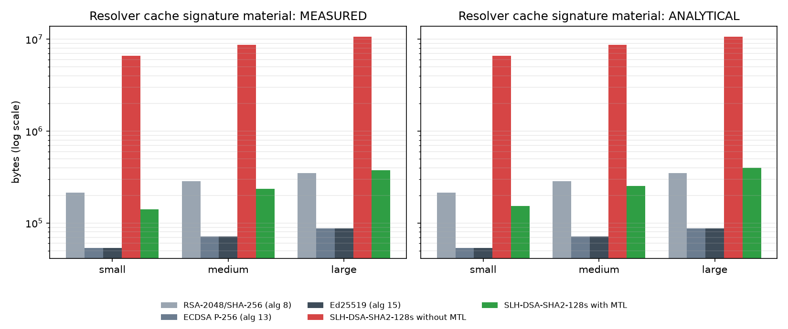
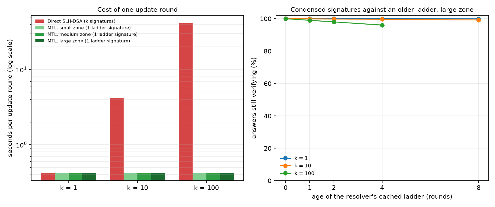

# Benchmarking MTL Mode for Post-Quantum DNSSEC Signatures
### PS-036 · PQC DNSSEC MTL Benchmark Using a Reference Implementation · AIORI Hackathon 3

Run `20261030T213016Z-ec2-ps036-offline-full10` · go/no-go gate: **GO** · 10 trials · seed 20261005 · stack `latest` · git `f12bb437582ce7816a5da9b3ed998d57f197f131-dirty`

## Abstract

Post-quantum signatures such as SLH-DSA-SHA2-128s are 7,856 bytes long. A DNSSEC response that carries one no longer fits the 1232-byte UDP size recommended for DNS, so resolvers fall back to TCP. Merkle Tree Ladder (MTL) mode (draft-harvey-cfrg-mtl-mode) signs a whole zone with one PQC signature over a Merkle ladder. Each RRset then carries only a short authentication path. We benchmark signing time, verification time, transmitted bytes and cache usage for DNSSEC zones of three sizes, comparing classical algorithms, direct SLH-DSA-SHA2-128s and SLH-DSA-SHA2-128s in MTL mode. All cryptography comes from the supplied Verisign MTL reference library, liboqs and OpenSSL, in a pinned container.

**Key results** (directly measured unless marked *extrapolated*):

- **Signing (medium zone, 1,005 RRsets, fully measured).** MTL signed the zone in 419.60 ms [418.36 ms–420.88 ms]; direct SLH-DSA took 420.29 s [419.03 s–421.13 s]. MTL was 1,002× [999×, 1,003×] faster (median of the per-trial ratios, interval in brackets).
- **Verification (medium zone, warm).** MTL took 4.12 ms for every RRSIG in the zone; direct SLH-DSA took 418.71 ms.
- **Signing (large zone, 10,005 RRsets).** MTL measured 435.52 ms. Direct SLH-DSA signed 1,000 sampled RRsets at 417.17 ms each, which extrapolates to 4,173.77 s for the whole zone *(extrapolated)*.
- **Response size (large zone).** At a 1232-byte EDNS buffer, 87% of MTL responses fit in UDP, compared with 0% for direct SLH-DSA.
- **Transmitted bytes (large zone).** The lookup workload transmitted 697.71 KB with MTL and 11.08 MB with direct SLH-DSA. 762 truncation and TCP-retry events became 245, plus 1 full-signature fetch.

## 1. Problem statement

DNSSEC relies on UDP, and on responses that fit a single unfragmented datagram (1232 bytes since DNS Flag Day 2020). Post-quantum signature schemes standardised by NIST have signatures that are one to two orders of magnitude larger than RSA or ECDSA. PS-036 asks for a reproducible measurement of what MTL mode changes for DNSSEC, compared with using the same PQC algorithm directly, using a reference implementation rather than new cryptography.

## 2. Background

- **DNSSEC** (RFC 4033–4035) signs each RRset. The RRSIG signature covers the RRSIG RDATA and the canonical RRset (RFC 4034 §3.1.8.1). NSEC3 (RFC 5155) proves non-existence.
- **SLH-DSA-SHA2-128s** (FIPS 205) is a stateless hash-based signature: 32-byte public key, 7,856-byte signature.
- **MTL mode** (draft-harvey-cfrg-mtl-mode-09) appends each message to a Merkle node set:
  - A *ladder* of rungs covering all messages is signed once with the underlying scheme.
  - A *condensed signature* is a short authentication path from one message to a rung.
  - A *full signature* is the condensed signature plus the signed ladder.
  - A verifier that has cached a ladder checks only hashes.
- **DNSSEC MTL mode** (draft-fregly-dnsop-slh-dsa-mtl-dnssec) prefixes the RRSIG signature with an MTL-Type byte. Validators request full signatures with an EDNS option, preferably over TCP.

## 3. Objectives and scope

Compare equivalent DNSSEC signing workloads with and without MTL, on three dataset sizes, measuring signing time, verification time and transmitted bytes. Report cache usage, keeping direct measurements separate from analytical estimates. Classical algorithms are included as a reference point. Out of scope, per PS-036: new cryptography, a resolver implementation, Internet deployment and any security proof.

| PS-036 requirement | How it is met | Where |
|---|---|---|
| One supported PQC signature algorithm | SLH-DSA-SHA2-128s (FIPS 205) in every PQC mode | §2, §4 |
| One mentor-tested MTL reference implementation | Verisign MTL C library at a pinned commit; no own crypto | §4, Appendix A |
| Three dataset sizes | small / medium / large synthetic zones | §4.3, Table 2 |
| Equivalent workloads with and without MTL | byte-identical RRsets and RFC 4034 signing inputs for every mode | §4.3 |
| Repeated trials, pinned software and hardware | N trials, one process per trial, interleaved order, pinned image, cpuset | §4.1, §4.5 |
| Signing time | measured per library call, whole-zone totals with 95% CIs | §5.1 |
| Verification time | warm (cached ladder) and cold (full signature) | §5.2 |
| Transmitted bytes | real DNS messages, 1232/4096 B buffers, TC + TCP fallback | §5.3 |
| Record configuration and workload parameters | config.yaml, environment.json, datasets table | Appendix A–B |
| Separate measured cache usage from analytical estimates | separate tables, `kind` column | §5.4 |
| Defer if implementation and fixtures unavailable | go/no-go gate; run aborts with NO-GO | §4.2, Appendix C |
| No new crypto, resolver, Internet deployment, security proof | none built or claimed | §7 |

## 4. Methodology

### 4.1 Pinned environment

| Item | Value |
|---|---|
| CPU | Intel(R) Xeon(R) Platinum 8488C |
| CPU affinity (cpuset) | [2] |
| Memory | MemTotal:       32313712 kB |
| Kernel | 6.18.56-125.164.amzn2023.x86_64 |
| OS | NAME="Fedora Linux"; VERSION="42 (Container Image)"; RELEASE_TYPE=stable; ID=fedora |
| Compiler | gcc (GCC) 15.2.1 20260123 (Red Hat 15.2.1-7) |
| Stack profile | latest |
| SLH-DSA call (liboqs name) | SLH_DSA_PURE_SHA2_128S |
| OpenSSL | OpenSSL 3.6.0 1 Oct 2025 (Library: OpenSSL 3.6.0 1 Oct 2025) |
| liboqs | 0.16.0 |
| MTL reference commit | 7cef0191da55048111d252a567b7614672424ed3 |
| MTL compile flags | -fPIC -Wall -Wextra -O2 |
| Python | 3.13.13 |
| Container image | sha256:cf50b7a63baa128bbd65de8e611f095ccb26720f71fc876543c4b0d1e354e9f4 |
| Harness sha256 | 533ab957c8eca39f… |

### 4.2 Go/no-go gate

PS-036 requires deferring the project if the implementation or its fixtures are not available. Before any measurement, the runner checks:

1. The reference library is installed.
2. Its own unit tests and test vectors pass.
3. Its key-generation, signing and verification tools round-trip with SLH-DSA-SHA2-128s-MTL, and a tampered message is rejected.
4. Every harness mode verifies its own output and rejects tampering, wrong keys, truncated signatures and signatures presented for another message.
5. The harness output is verified by a different program: `mtlverify` for MTL and OpenSSL for the non-MTL SLH-DSA signatures (an interoperability check, not a known-answer test).

The run aborts with `NO-GO` otherwise. The outcome of each check is listed in Appendix C.

### 4.3 Workloads

Each dataset is a deterministic synthetic zone `bench.example.`:

- **small (60% of names):** one A or AAAA record
- **medium (30%):** three MX or four AAAA records
- **large (10%):** one 1–2 KB TXT record

The zone also has the apex SOA, NS, DNSKEY and NSEC3PARAM, and a complete NSEC3 chain (0 iterations, RFC 9276). Each RRset is one signing message. The RFC 4034 signing inputs are produced by dnspython; a test checks that dnspython's standard validator accepts signatures over these exact bytes. Every mode signs the same RRsets with fixed inception and expiration times. The only differences between modes are the RRSIG algorithm number, key tag and DNSKEY, which belong to the signed data.

| dataset | n_names | rrsets | apex | small | medium | large | nsec3 | signing_input_bytes |
|---|---|---|---|---|---|---|---|---|
| small | 50 | 105 | 4 | 35 | 10 | 5 | 51 | 20.05 KB |
| medium | 500 | 1,005 | 4 | 303 | 147 | 50 | 501 | 207.02 KB |
| large | 5,000 | 10,005 | 4 | 3,042 | 1,504 | 454 | 5,001 | 1.94 MB |

*Table 2: datasets.*

### 4.4 Modes

| Mode | Harness path | Library algorithm | DNSSEC alg # |
|---|---|---|---|
| RSA-2048/SHA-256 (alg 8) | classical | rsa-2048 | 8 |
| ECDSA P-256 (alg 13) | classical | ecdsa-p256 | 13 |
| Ed25519 (alg 15) | classical | ed25519 | 15 |
| SLH-DSA-SHA2-128s without MTL | direct | SLH_DSA_PURE_SHA2_128S | 249 |
| SLH-DSA-SHA2-128s with MTL | mtl | SLH-DSA-SHA2-128s-MTL-SHA2-128 | 50 |

The DNSSEC algorithm numbers for SLH-DSA (direct and MTL) and the EDNS option `mtl-mode-full` (code 65001) are lab placeholders.

### 4.5 Measurement procedure

- Each trial runs one harness process per mode and dataset. The process links the reference library, liboqs and OpenSSL, and times each library call with `CLOCK_MONOTONIC_RAW`.
- Modes run in a seeded random order inside each trial, after 1 warm-up trial(s). There are 10 measured trials.
- **MTL signing (whole zone)** = append every RRset + sign the ladder once + extract every condensed signature.
- **MTL warm verification** = verify the ladder once + verify every condensed signature against it. The verifier is built from the exported public key only.
- **MTL cold verification** = full signature without a cached ladder, on 64 RRsets.
- **Noise.** The clock's own cost and resolution are measured at the start of the run (Table 4d), and `ed25519` runs twice inside every trial as an A/A control (Table 4c).
- **Correctness.** A trial counts only if every signature verifies and tampered messages, signatures and ladders are rejected.
- **Statistics.** We report the median across trials with a distribution-free confidence interval of the median (order statistics). With 10 trials it is the 98% CI of the median over 10 trials.
- **Transmitted bytes.** Measured on real DNS messages encoded by dnspython, using the signatures from trial 0.

## 5. Results

### 5.1 Signing time




*Figure 1: whole-zone signing time (log scale)*

| dataset | mode | RRsets signed | sign zone, median [CI] | per RRset | zone total (extrapolated) | keygen |
|---|---|---|---|---|---|---|
| small | RSA-2048/SHA-256 (alg 8) | 105/105 | 27.56 ms [27.47 ms–27.63 ms] | 262.5 µs |  | 28.80 ms |
| small | ECDSA P-256 (alg 13) | 105/105 | 2.30 ms [2.30 ms–2.37 ms] | 21.9 µs |  | 1.02 ms |
| small | Ed25519 (alg 15) | 105/105 | 2.93 ms [2.91 ms–3.08 ms] | 27.9 µs |  | 989.3 µs |
| small | SLH-DSA-SHA2-128s without MTL | 105/105 | 43.90 s [43.79 s–43.92 s] | 418.10 ms |  | 55.81 ms |
| small | SLH-DSA-SHA2-128s with MTL | 105/105 | 417.99 ms [417.21 ms–419.28 ms] | 3.98 ms |  | 55.62 ms |
| medium | RSA-2048/SHA-256 (alg 8) | 1,005/1,005 | 259.83 ms [259.69 ms–259.87 ms] | 258.5 µs |  | 23.69 ms |
| medium | ECDSA P-256 (alg 13) | 1,005/1,005 | 20.35 ms [20.34 ms–20.49 ms] | 20.2 µs |  | 996.4 µs |
| medium | Ed25519 (alg 15) | 1,005/1,005 | 27.07 ms [27.05 ms–27.36 ms] | 26.9 µs |  | 1.02 ms |
| medium | SLH-DSA-SHA2-128s without MTL | 1,005/1,005 | 420.29 s [419.03 s–421.13 s] | 418.20 ms |  | 55.58 ms |
| medium | SLH-DSA-SHA2-128s with MTL | 1,005/1,005 | 419.60 ms [418.36 ms–420.88 ms] | 417.5 µs |  | 55.51 ms |
| large | RSA-2048/SHA-256 (alg 8) | 10,005/10,005 | 2.58 s [2.58 s–2.58 s] | 258.1 µs |  | 24.18 ms |
| large | ECDSA P-256 (alg 13) | 10,005/10,005 | 200.57 ms [200.31 ms–200.95 ms] | 20.0 µs |  | 1.07 ms |
| large | Ed25519 (alg 15) | 10,005/10,005 | 268.05 ms [267.59 ms–268.36 ms] | 26.8 µs |  | 1.12 ms |
| large | SLH-DSA-SHA2-128s without MTL | 1,000/10,005 | 417.17 s [416.95 s–418.48 s] | 417.17 ms | 4,173.77 s | 55.57 ms |
| large | SLH-DSA-SHA2-128s with MTL | 10,005/10,005 | 435.52 ms [434.49 ms–436.72 ms] | 43.5 µs |  | 55.75 ms |

*Table 3: signing time.*

MTL signing time breakdown (medians):

| dataset | append all RRsets | sign ladder (1 SLH-DSA) | extract condensed sigs |
|---|---|---|---|
| small | 218.0 µs | 417.74 ms | 33.1 µs |
| medium | 1.45 ms | 417.75 ms | 388.9 µs |
| large | 13.62 ms | 416.68 ms | 5.12 ms |

### 5.2 Verification time




*Figure 2: whole-zone verification time with a cached ladder (log scale)*

| dataset | mode | verify zone (warm), median [CI] | per RRset (warm) | one signature, cold | checks passed |
|---|---|---|---|---|---|
| small | RSA-2048/SHA-256 (alg 8) | 1.75 ms [1.75 ms–1.76 ms] | 16.7 µs | 16.6 µs | yes |
| small | ECDSA P-256 (alg 13) | 6.51 ms [6.48 ms–6.54 ms] | 62.0 µs | 61.5 µs | yes |
| small | Ed25519 (alg 15) | 9.30 ms [9.28 ms–9.37 ms] | 88.6 µs | 88.2 µs | yes |
| small | SLH-DSA-SHA2-128s without MTL | 43.47 ms [43.29 ms–43.97 ms] | 414.0 µs | 416.0 µs | yes |
| small | SLH-DSA-SHA2-128s with MTL | 716.9 µs [701.9 µs–735.8 µs] | 6.8 µs | 422.1 µs | yes |
| medium | RSA-2048/SHA-256 (alg 8) | 16.71 ms [16.70 ms–16.73 ms] | 16.6 µs | 16.5 µs | yes |
| medium | ECDSA P-256 (alg 13) | 61.96 ms [61.93 ms–61.99 ms] | 61.7 µs | 61.5 µs | yes |
| medium | Ed25519 (alg 15) | 88.87 ms [88.78 ms–89.04 ms] | 88.4 µs | 88.2 µs | yes |
| medium | SLH-DSA-SHA2-128s without MTL | 418.71 ms [417.16 ms–419.37 ms] | 416.6 µs | 417.4 µs | yes |
| medium | SLH-DSA-SHA2-128s with MTL | 4.12 ms [4.10 ms–4.15 ms] | 4.1 µs | 413.6 µs | yes |
| large | RSA-2048/SHA-256 (alg 8) | 166.27 ms [166.08 ms–166.55 ms] | 16.6 µs | 16.5 µs | yes |
| large | ECDSA P-256 (alg 13) | 616.68 ms [616.47 ms–617.01 ms] | 61.6 µs | 61.5 µs | yes |
| large | Ed25519 (alg 15) | 883.49 ms [882.85 ms–884.25 ms] | 88.3 µs | 88.1 µs | yes |
| large | SLH-DSA-SHA2-128s without MTL | 417.01 ms [415.07 ms–417.84 ms] | 417.0 µs | 417.7 µs | yes |
| large | SLH-DSA-SHA2-128s with MTL | 51.53 ms [51.48 ms–51.70 ms] | 5.2 µs | 417.9 µs | yes |

*Table 4: verification time. For MTL, "cold" means a full signature verified without a cached ladder; for other modes it is the median single-signature verification.*

#### Paired ratios: direct SLH-DSA divided by MTL

Every mode runs inside each trial, so each trial gives one ratio. The table shows the median of those per-trial ratios and its distribution-free interval; it is what supports a statement such as "N times faster".

| dataset | metric | trials | ratio, median [interval] | interval covers | basis | against the A/A noise floor |
|---|---|---|---|---|---|---|
| small | signing | 10 | 105× [105×, 105×] | 98% | measured | clearly outside (±2.4%) |
| medium | signing | 10 | 1,002× [999×, 1,003×] | 98% | measured | clearly outside (±0.3%) |
| large | signing | 10 | 9,590× [9,559×, 9,621×] | 98% | extrapolated direct total | clearly outside (±0.2%) |
| small | verification (warm) | 10 | 61.1× [58.9×, 61.7×] | 98% | measured | clearly outside (±0.7%) |
| medium | verification (warm) | 10 | 102× [101×, 102×] | 98% | measured | clearly outside (±0.3%) |
| large | verification (warm) | 10 | 80.8× [80.4×, 81.2×] | 98% | extrapolated direct total | clearly outside (±0.1%) |

*Table 4b: paired per-trial ratios.*

#### Measurement noise: the A/A control

`ed25519` ran twice inside every trial, on the same input, as if it were two different modes. The true ratio is 1, so the table below is the measurement's own noise. A difference between two modes that is smaller than this band must not be reported as a difference.

| dataset | metric | trials | A/A ratio, median [interval] | noise band |
|---|---|---|---|---|
| small | signing | 10 | 0.998 [0.976, 1.008] | ±2.4% |
| medium | signing | 10 | 1.000 [0.999, 1.003] | ±0.3% |
| large | signing | 10 | 1.000 [0.998, 1.002] | ±0.2% |
| small | verification (warm) | 10 | 0.999 [0.995, 1.007] | ±0.7% |
| medium | verification (warm) | 10 | 1.000 [0.998, 1.003] | ±0.3% |
| large | verification (warm) | 10 | 1.000 [0.999, 1.001] | ±0.1% |

*Table 4c: A/A control (one mode against its own copy).*

#### Measurement noise: the timer

Every library call is timed with `CLOCK_MONOTONIC_RAW`. An empty timed region cost 21 ns (median; p99 23 ns), and the smallest step the clock was seen to take is 20 ns. The two fastest operations were timed both one call at a time (as in the benchmark) and as 1,000 calls in one region divided by 1,000:

| operation | per call, median | batch of 1,000, per call | difference | timer cost as share of the operation |
|---|---|---|---|---|
| ed25519 verify | 86.4 µs | 86.9 µs | -0.6% | 0.0% |
| mtl condensed verify | 0.6 µs | 0.6 µs | +2.3% | 3.4% |

*Table 4d: timer calibration.* Per-call timing is reliable for these operations (timer cost at most 5% of the operation).

### 5.3 Transmitted bytes

| dataset | mode | signature bytes (median / max) | signed ladder bytes | public key bytes |
|---|---|---|---|---|
| small | RSA-2048/SHA-256 (alg 8) | 256 / 256 |  | 260 |
| small | ECDSA P-256 (alg 13) | 64 / 64 |  | 64 |
| small | Ed25519 (alg 15) | 64 / 64 |  | 32 |
| small | SLH-DSA-SHA2-128s without MTL | 7,856 / 7,856 |  | 32 |
| small | SLH-DSA-SHA2-128s with MTL | 172 / 172 | 8,024 | 32 |
| medium | RSA-2048/SHA-256 (alg 8) | 256 / 256 |  | 260 |
| medium | ECDSA P-256 (alg 13) | 64 / 64 |  | 64 |
| medium | Ed25519 (alg 15) | 64 / 64 |  | 32 |
| medium | SLH-DSA-SHA2-128s without MTL | 7,856 / 7,856 |  | 32 |
| medium | SLH-DSA-SHA2-128s with MTL | 220 / 220 | 8,152 | 32 |
| large | RSA-2048/SHA-256 (alg 8) | 256 / 256 |  | 260 |
| large | ECDSA P-256 (alg 13) | 64 / 64 |  | 64 |
| large | Ed25519 (alg 15) | 64 / 64 |  | 32 |
| large | SLH-DSA-SHA2-128s without MTL | 7,856 / 7,856 |  | 32 |
| large | SLH-DSA-SHA2-128s with MTL | 284 / 284 | 8,120 | 32 |

*Table 5: signature sizes measured on library output. The MTL RRSIG field adds a 1-byte MTL-Type prefix.*




*Figure 3: DNS response sizes by record class, measured*

| dataset | record_class | RSA-2048/SHA-256 (alg 8) | ECDSA P-256 (alg 13) | Ed25519 (alg 15) | SLH-DSA-SHA2-128s without MTL | SLH-DSA-SHA2-128s with MTL |
|---|---|---|---|---|---|---|
| small | small | 100.0 | 100.0 | 100.0 | 0.0 | 100.0 |
| small | medium | 100.0 | 100.0 | 100.0 | 0.0 | 100.0 |
| small | large | 0.0 | 0.0 | 0.0 | 0.0 | 0.0 |
| small | nxdomain | 7.5 | 100.0 | 100.0 | 0.0 | 100.0 |
| medium | small | 100.0 | 100.0 | 100.0 | 0.0 | 100.0 |
| medium | medium | 100.0 | 100.0 | 100.0 | 0.0 | 100.0 |
| medium | large | 0.0 | 2.0 | 2.0 | 0.0 | 0.0 |
| medium | nxdomain | 0.5 | 100.0 | 100.0 | 0.0 | 0.5 |
| large | small | 100.0 | 100.0 | 100.0 | 0.0 | 100.0 |
| large | medium | 100.0 | 100.0 | 100.0 | 0.0 | 100.0 |
| large | large | 0.0 | 2.6 | 2.6 | 0.0 | 0.0 |
| large | nxdomain | 0.0 | 100.0 | 100.0 | 0.0 | 0.0 |

*Table 6: percentage of responses that fit a 1232-byte EDNS UDP buffer without truncation.*




*Figure 4: total DNS bytes for the lookup workload at a 1232-byte buffer*

| dataset | mode | UDP buffer | responses | DNS bytes | of which RRSIG sig bytes | TC → TCP | MTL full fetches | round trips (est.) |
|---|---|---|---|---|---|---|---|---|
| small | RSA-2048/SHA-256 (alg 8) | 1232 | 251 | 371.25 KB | 215.30 KB | 195 | 0 | 641 |
| small | RSA-2048/SHA-256 (alg 8) | 4096 | 251 | 348.29 KB | 215.30 KB | 0 | 0 | 251 |
| small | ECDSA P-256 (alg 13) | 1232 | 251 | 187.17 KB | 53.82 KB | 5 | 0 | 261 |
| small | ECDSA P-256 (alg 13) | 4096 | 251 | 186.62 KB | 53.82 KB | 0 | 0 | 251 |
| small | Ed25519 (alg 15) | 1232 | 251 | 187.13 KB | 53.82 KB | 5 | 0 | 261 |
| small | Ed25519 (alg 15) | 4096 | 251 | 186.59 KB | 53.82 KB | 0 | 0 | 251 |
| small | SLH-DSA-SHA2-128s without MTL | 1232 | 251 | 6.78 MB | 6.61 MB | 251 | 0 | 753 |
| small | SLH-DSA-SHA2-128s without MTL | 4096 | 251 | 6.78 MB | 6.61 MB | 251 | 0 | 753 |
| small | SLH-DSA-SHA2-128s with MTL | 1232 | 251 | 274.88 KB | 141.39 KB | 5 | 1 | 263 |
| small | SLH-DSA-SHA2-128s with MTL | 4096 | 251 | 274.33 KB | 141.39 KB | 0 | 1 | 253 |
| medium | RSA-2048/SHA-256 (alg 8) | 1232 | 508 | 538.68 KB | 283.65 KB | 230 | 0 | 968 |
| medium | RSA-2048/SHA-256 (alg 8) | 4096 | 508 | 511.78 KB | 283.65 KB | 0 | 0 | 508 |
| medium | ECDSA P-256 (alg 13) | 1232 | 508 | 302.04 KB | 70.91 KB | 29 | 0 | 566 |
| medium | ECDSA P-256 (alg 13) | 4096 | 508 | 298.85 KB | 70.91 KB | 0 | 0 | 508 |
| medium | Ed25519 (alg 15) | 1232 | 508 | 302.01 KB | 70.91 KB | 29 | 0 | 566 |
| medium | Ed25519 (alg 15) | 4096 | 508 | 298.82 KB | 70.91 KB | 0 | 0 | 508 |
| medium | SLH-DSA-SHA2-128s without MTL | 1232 | 508 | 9.00 MB | 8.70 MB | 508 | 0 | 1524 |
| medium | SLH-DSA-SHA2-128s without MTL | 4096 | 508 | 9.00 MB | 8.70 MB | 508 | 0 | 1524 |
| medium | SLH-DSA-SHA2-128s with MTL | 1232 | 508 | 489.45 KB | 234.70 KB | 228 | 1 | 966 |
| medium | SLH-DSA-SHA2-128s with MTL | 4096 | 508 | 462.79 KB | 234.70 KB | 0 | 1 | 510 |
| large | RSA-2048/SHA-256 (alg 8) | 1232 | 762 | 669.66 KB | 348.67 KB | 245 | 0 | 1252 |
| large | RSA-2048/SHA-256 (alg 8) | 4096 | 762 | 641.11 KB | 348.67 KB | 0 | 0 | 762 |
| large | ECDSA P-256 (alg 13) | 1232 | 762 | 384.14 KB | 87.17 KB | 43 | 0 | 848 |
| large | ECDSA P-256 (alg 13) | 4096 | 762 | 379.41 KB | 87.17 KB | 0 | 0 | 762 |
| large | Ed25519 (alg 15) | 1232 | 762 | 384.10 KB | 87.17 KB | 43 | 0 | 848 |
| large | Ed25519 (alg 15) | 4096 | 762 | 379.37 KB | 87.17 KB | 0 | 0 | 762 |
| large | SLH-DSA-SHA2-128s without MTL | 1232 | 762 | 11.08 MB | 10.70 MB | 762 | 0 | 2286 |
| large | SLH-DSA-SHA2-128s without MTL | 4096 | 762 | 11.08 MB | 10.70 MB | 762 | 0 | 2286 |
| large | SLH-DSA-SHA2-128s with MTL | 1232 | 762 | 697.71 KB | 376.77 KB | 245 | 1 | 1254 |
| large | SLH-DSA-SHA2-128s with MTL | 4096 | 762 | 669.16 KB | 376.77 KB | 0 | 1 | 764 |

*Table 7: workload accounting. Workload: 2000 lookups following a Zipf(s=1.1) distribution, with 10% going to non-existent names. Assumptions:*

- *A cached answer is not re-sent.*
- *An oversize answer costs a UDP query, a TC=1 reply and a TCP retry.*
- *An MTL validator fetches one full signature over TCP on first contact.*

*Byte counts are measured; round-trip and packet counts are analytical.*

### 5.4 Cache usage: measured




*Figure 5: resolver cache signature material. Left: measured. Right: analytical.*

| dataset | mode | cached responses | RRSIGs | wire bytes | signature bytes | ladder bytes | Python heap retained |
|---|---|---|---|---|---|---|---|
| small | RSA-2048/SHA-256 (alg 8) | 251 | 841 | 334.19 KB | 215.30 KB | 0 B | 2.82 MB |
| small | ECDSA P-256 (alg 13) | 251 | 841 | 172.53 KB | 53.82 KB | 0 B | 2.66 MB |
| small | Ed25519 (alg 15) | 251 | 841 | 172.49 KB | 53.82 KB | 0 B | 2.66 MB |
| small | SLH-DSA-SHA2-128s without MTL | 251 | 841 | 6.73 MB | 6.61 MB | 0 B | 9.60 MB |
| small | SLH-DSA-SHA2-128s with MTL | 251 | 841 | 251.86 KB | 133.19 KB | 8.02 KB | 3.13 MB |
| medium | RSA-2048/SHA-256 (alg 8) | 508 | 1,108 | 484.07 KB | 283.65 KB | 0 B | 4.25 MB |
| medium | ECDSA P-256 (alg 13) | 508 | 1,108 | 271.14 KB | 70.91 KB | 0 B | 4.04 MB |
| medium | Ed25519 (alg 15) | 508 | 1,108 | 271.11 KB | 70.91 KB | 0 B | 4.04 MB |
| medium | SLH-DSA-SHA2-128s without MTL | 508 | 1,108 | 8.91 MB | 8.70 MB | 0 B | 13.17 MB |
| medium | SLH-DSA-SHA2-128s with MTL | 508 | 1,108 | 426.52 KB | 226.32 KB | 8.15 KB | 4.69 MB |
| large | RSA-2048/SHA-256 (alg 8) | 762 | 1,362 | 599.93 KB | 348.67 KB | 0 B | 5.62 MB |
| large | ECDSA P-256 (alg 13) | 762 | 1,362 | 338.23 KB | 87.17 KB | 0 B | 5.36 MB |
| large | Ed25519 (alg 15) | 762 | 1,362 | 338.20 KB | 87.17 KB | 0 B | 5.36 MB |
| large | SLH-DSA-SHA2-128s without MTL | 762 | 1,362 | 10.96 MB | 10.70 MB | 0 B | 16.59 MB |
| large | SLH-DSA-SHA2-128s with MTL | 762 | 1,362 | 619.39 KB | 368.36 KB | 8.12 KB | 6.25 MB |

*Table 8: measured. The cached responses are those transmitted in Table 7, parsed from wire and stored in dnspython's `LRUCache`. Heap figures come from tracemalloc.*

| dataset | MTL signer RSS growth while appending | max RSS |
|---|---|---|
| small | 180.22 KB | 8.13 MB |
| medium | 309.25 KB | 8.54 MB |
| large | 1.10 MB | 14.21 MB |

*Table 9: measured signer state of the reference library process (`/proc/self/statm`, page-granular, so growth below a few pages is within measurement resolution).*

### 5.5 Cache usage: analytical estimates

| dataset | mode | RRSIGs | max bytes per signature | ladder bytes (max) | signature material |
|---|---|---|---|---|---|
| small | RSA-2048/SHA-256 (alg 8) | 841 | 256 | 0 B | 215.30 KB |
| small | ECDSA P-256 (alg 13) | 841 | 64 | 0 B | 53.82 KB |
| small | Ed25519 (alg 15) | 841 | 64 | 0 B | 53.82 KB |
| small | SLH-DSA-SHA2-128s without MTL | 841 | 7,856 | 0 B | 6.61 MB |
| small | SLH-DSA-SHA2-128s with MTL | 841 | 173 | 8.15 KB | 153.65 KB |
| medium | RSA-2048/SHA-256 (alg 8) | 1,108 | 256 | 0 B | 283.65 KB |
| medium | ECDSA P-256 (alg 13) | 1,108 | 64 | 0 B | 70.91 KB |
| medium | Ed25519 (alg 15) | 1,108 | 64 | 0 B | 70.91 KB |
| medium | SLH-DSA-SHA2-128s without MTL | 1,108 | 7,856 | 0 B | 8.70 MB |
| medium | SLH-DSA-SHA2-128s with MTL | 1,108 | 221 | 8.25 KB | 253.12 KB |
| large | RSA-2048/SHA-256 (alg 8) | 1,362 | 256 | 0 B | 348.67 KB |
| large | ECDSA P-256 (alg 13) | 1,362 | 64 | 0 B | 87.17 KB |
| large | Ed25519 (alg 15) | 1,362 | 64 | 0 B | 87.17 KB |
| large | SLH-DSA-SHA2-128s without MTL | 1,362 | 7,856 | 0 B | 10.70 MB |
| large | SLH-DSA-SHA2-128s with MTL | 1,362 | 285 | 8.38 KB | 396.55 KB |

| dataset | node-set hash storage (2N−1)·n + N·n |
|---|---|
| small | 5.02 KB |
| medium | 48.22 KB |
| large | 480.22 KB |

*Table 10: analytical estimates from the draft-harvey section 12 size formulas, for the same RRSIG counts as Table 8. These are estimates, not measurements.*

### 5.6 MTL sizes compared with the draft formulas

| dataset | quantity | kind | bytes |
|---|---|---|---|
| small | condensed_signature | measured_max | 172 |
| small | condensed_signature | analytical_max | 172 |
| small | signed_ladder | measured | 8,024 |
| small | signed_ladder | analytical_max | 8,152 |
| small | rungs | analytical | 4 |
| small | zone_signature_storage_mtl | analytical | 26,212 |
| small | zone_signature_storage_mtl | measured | 25,092 |
| small | zone_signature_storage_direct | analytical | 824,880 |
| small | zone_signature_storage_direct | measured | 824,880 |
| medium | condensed_signature | measured_max | 220 |
| medium | condensed_signature | analytical_max | 220 |
| medium | signed_ladder | measured | 8,152 |
| medium | signed_ladder | analytical_max | 8,248 |
| medium | rungs | analytical | 8 |
| medium | zone_signature_storage_mtl | analytical | 229,348 |
| medium | zone_signature_storage_mtl | measured | 214,580 |
| medium | zone_signature_storage_direct | analytical | 7,895,280 |
| medium | zone_signature_storage_direct | measured | 7,895,280 |
| large | condensed_signature | measured_max | 284 |
| large | condensed_signature | analytical_max | 284 |
| large | signed_ladder | measured | 8,120 |
| large | signed_ladder | analytical_max | 8,376 |
| large | rungs | analytical | 7 |
| large | zone_signature_storage_mtl | analytical | 2,849,796 |
| large | zone_signature_storage_mtl | measured | 2,743,924 |
| large | zone_signature_storage_direct | analytical | 78,599,280 |
| large | zone_signature_storage_direct | measured_per_sig_x_n | 78,599,280 |

*Table 11: measured MTL sizes next to the section 12 maxima.*

### 5.7 Evolving zone: updates and cached ladders

MTL is built for a series that keeps growing, so a single signed zone is its best case. Here each series starts from the full dataset and runs rounds in which **k** RRsets change (k = 1, 10, 100; 10, 10, 5 rounds). Every change appends a new leaf, old leaves never leave the series, and each round signs one new ladder. The baseline signs every changed RRset with plain SLH-DSA. All figures in Tables 12 to 15 are measured with the reference library; an RRset 'change' is modelled as the same-size message with its last 8 bytes replaced, chosen uniformly at random, so the cost of an update is real but its content is synthetic.

#### Cost of one update round

| dataset | k | MTL: append k leaves + 1 ladder signature | direct: k signatures | direct ÷ MTL (per-trial, interval) | resolver verifies, MTL (1 ladder) | resolver verifies, direct (k signatures) |
|---|---|---|---|---|---|---|
| small | 1 | 417.74 ms [417.14 ms–419.08 ms] | 417.31 ms | 1.00× [1.00×, 1.00×] | 419.4 µs | 418.0 µs |
| small | 10 | 417.63 ms [417.15 ms–418.64 ms] | 4.17 s | 9.99× [9.98×, 10.02×] | 416.4 µs | 4.19 ms |
| small | 100 | 417.66 ms [416.49 ms–418.45 ms] | 41.71 s | 99.9× [99.7×, 100.4×] | 415.9 µs | 41.87 ms |
| medium | 1 | 417.58 ms [416.67 ms–418.26 ms] | 417.31 ms | 1.00× [1.00×, 1.00×] | 418.7 µs | 418.0 µs |
| medium | 10 | 417.22 ms [417.11 ms–417.94 ms] | 4.17 s | 10.0× [10.0×, 10.0×] | 420.2 µs | 4.19 ms |
| medium | 100 | 417.78 ms [416.51 ms–418.28 ms] | 41.71 s | 99.9× [99.7×, 100.3×] | 418.7 µs | 41.87 ms |
| large | 1 | 417.78 ms [416.99 ms–418.66 ms] | 417.31 ms | 1.00× [1.00×, 1.00×] | 420.9 µs | 418.0 µs |
| large | 10 | 417.89 ms [416.89 ms–418.58 ms] | 4.17 s | 9.99× [9.97×, 10.04×] | 423.4 µs | 4.19 ms |
| large | 100 | 418.21 ms [417.32 ms–418.38 ms] | 41.71 s | 99.9× [99.7×, 100.2×] | 422.7 µs | 41.87 ms |

*Table 12: cost of one update round, median over rounds and trials. 'Resolver verifies' is the work to take in the update: one ladder signature against k signatures.*




*Figure 6: cost of one update round (left) and how long a cached ladder keeps covering the current answers (right)*

**Reading.** MTL is not faster at k = 1: it still signs one ladder per round, the same SLH-DSA signature direct signing needs for one changed RRset. As k grows, direct signing pays k signatures per round and MTL still pays one, so the advantage grows roughly with k. At small k, MTL's gain is in bytes and in verification, not in signing time.

#### How long a cached ladder stays useful

| dataset | k | ladder 1 round(s) old | ladder 2 round(s) old | ladder 4 round(s) old | ladder 8 round(s) old |
|---|---|---|---|---|---|
| small | 1 | 99.0% | 98.1% | 96.2% | 92.4% |
| small | 10 | 90.5% | 81.8% | 67.5% | 46.0% |
| small | 100 | 4.8% | 0.0% | 0.0% | nan% |
| medium | 1 | 99.9% | 99.8% | 99.6% | 99.2% |
| medium | 10 | 99.0% | 98.0% | 96.1% | 92.4% |
| medium | 100 | 90.0% | 81.0% | 66.1% | nan% |
| large | 1 | 100.0% | 100.0% | 100.0% | 99.9% |
| large | 10 | 99.9% | 99.8% | 99.6% | 99.2% |
| large | 100 | 99.0% | 98.0% | 96.1% | nan% |

*Table 13: share of the current zone's RRsets whose condensed signature verifies against the cached ladder of that age (measured by the library, every RRset, every round in which that age exists). A leaf appended after the cached ladder was signed has no rung in it and is rejected; every other RRset verifies. The rejected share is therefore the share of RRsets changed since that ladder, and it is the share of answers that need a full signature (about 8 KB over TCP) from a resolver that does not refresh.*

#### Growth of the series

| dataset | k | rounds | leaves | rungs at the end | signed ladder | largest condensed signature | signer RSS |
|---|---|---|---|---|---|---|---|
| small | 1 | 10 | 105 → 115 | 5 | 8.02 KB → 8.06 KB | 172 B → 172 B | 8.09 MB |
| small | 10 | 10 | 105 → 205 | 5 | 8.02 KB → 8.06 KB | 172 B → 188 B | 8.38 MB |
| small | 100 | 5 | 105 → 605 | 6 | 8.02 KB → 8.09 KB | 172 B → 220 B | 8.37 MB |
| medium | 1 | 10 | 1,005 → 1,015 | 9 | 8.15 KB → 8.18 KB | 220 B → 220 B | 8.65 MB |
| medium | 10 | 10 | 1,005 → 1,105 | 4 | 8.15 KB → 8.02 KB | 220 B → 236 B | 8.86 MB |
| medium | 100 | 5 | 1,005 → 1,505 | 6 | 8.15 KB → 8.09 KB | 220 B → 236 B | 8.95 MB |
| large | 1 | 10 | 10,005 → 10,015 | 9 | 8.12 KB → 8.18 KB | 284 B → 284 B | 14.44 MB |
| large | 10 | 10 | 10,005 → 10,105 | 9 | 8.12 KB → 8.18 KB | 284 B → 284 B | 14.59 MB |
| large | 100 | 5 | 10,005 → 10,505 | 5 | 8.12 KB → 8.06 KB | 284 B → 284 B | 16.23 MB |

*Table 14: the series only grows. Rungs follow the binary breakdown of the leaf count (11 leaves = 8 + 2 + 1), so the ladder size moves up and down while the leaf count rises; the condensed signature grows by 16 bytes whenever the leaf count reaches a power of two.*

#### Published signatures when the ladder changes

| dataset | k | lowest share still valid | rounds with any signature invalidated |
|---|---|---|---|
| small | 1 | 85.6% | 10 |
| small | 10 | 0.0% | 10 |
| small | 100 | 0.0% | 5 |
| medium | 1 | 98.1% | 10 |
| medium | 10 | 0.0% | 10 |
| medium | 100 | 0.0% | 5 |
| large | 1 | 99.9% | 10 |
| large | 10 | 99.0% | 10 |
| large | 100 | 79.0% | 5 |

*Table 15: condensed signatures issued when a leaf was created, verified against the newest ladder. When rungs merge as the series grows, the path of an earlier signature no longer ends at a rung of the new ladder: it still verifies against the older ladder, but the signature has to be reissued for resolvers that hold the new one. At a power-of-two leaf count every earlier signature is affected.*

#### Signature bytes per answer, large zone (derived)

| k | ladder 1 old | ladder 2 old | ladder 4 old | ladder 8 old |
|---|---|---|---|---|
| 1 | 274 B | 275 B | 277 B | 280 B |
| 10 | 281 B | 290 B | 306 B | 339 B |
| 100 | 358 B | 442 B | 605 B | nan B |

*Table 16: derived, not measured. Measured condensed size, plus the measured uncovered share times a full signature (condensed + ladder). It is an upper bound: it assumes every uncovered answer fetches a full signature, while a real resolver refreshes its ladder once and then covers the rest. Compare with 7,856 B for plain SLH-DSA.*

## 6. Discussion

- **Signing.** Direct SLH-DSA performs one expensive hash-based signature per RRset. MTL performs one per zone, for the ladder, plus hashing per RRset. The gap therefore grows with zone size.
- **Verification.** With a cached ladder, MTL checks only an authentication path for each RRset. The SLH-DSA verification is paid once per ladder.
- **Transmitted bytes.** Direct SLH-DSA responses never fit 1232 bytes, because one signature is 7,856 bytes. MTL condensed signatures grow with log2 of the number of RRsets in the series. The MTL responses that still truncate at 1232 bytes are:
  - small zone (condensed signature 172 B): below 100%: large 0%.
  - medium zone (condensed signature 220 B): below 100%: large 0%, nxdomain 0%.
  - large zone (condensed signature 284 B): below 100%: large 0%, nxdomain 0%.
  - Large TXT answers exceed the limit even with classical signatures. An NXDOMAIN carries up to four RRSIGs (SOA and up to three NSEC3), so negative answers outgrow UDP first as the zone grows. Compact denial of existence, or splitting a zone into several MTL series, would reduce this; both are left as future work.
- **Cost of MTL.** It moves cost to first contact, where one full signature (the ladder) is fetched over TCP. A ladder covers a zone version: re-signing after a change produces a new ladder that validators must fetch again.

## 7. Limitations

- **Timing scope.** CPU timings are for one pinned core on the hardware recorded above, with the pinned library builds. They are not general performance claims. 
- **Transport model.** Transmitted bytes come from a message-level model, not a resolver or server. Real resolvers differ in caching, retries and EDNS behaviour.
- **Placeholder code points.** The algorithm numbers and the EDNS option code are not IANA-assigned.
- **Fixture coverage.** The reference library's bundled known-answer vectors cover the scheme named in Appendix C. SLH-DSA-SHA2-128s-MTL is validated by the tool round trip and the harness gates.
- **Compiler flags.** The MTL library is compiled with optimisation (see methodology). The as-shipped debug build is available as an ablation.
- **No security claims.** This work makes no security claims and no new cryptography is introduced.

## 8. Conclusion

On equivalent DNSSEC workloads and the same underlying PQC algorithm, MTL mode in the reference implementation replaces per-RRset SLH-DSA signatures with short authentication paths. In this environment it reduced zone signing time, warm verification time and transmitted bytes. In the large zone, the share of responses that fit a 1232-byte UDP buffer rose from 0% to 87%. The costs are one full-signature fetch per validator for each zone version, and negative answers that carry several condensed signatures grow with zone size. All figures are measured on the pinned environment, except those explicitly marked as extrapolated or analytical, and are reproducible with the commands below.

## 9. Reproducing this report

```bash
scripts/run_benchmark.sh preflight                     # build the image from the stack profile, go/no-go gate
scripts/run_benchmark.sh configs/scenarios.yaml        # full run -> results/runs/<id>/
python -m cipherops.runner report --run results/runs/20261030T213016Z-ec2-ps036-offline-full10
```

### Demonstration pseudocode

```python
# Signer: one MTL series per zone, built with the reference library
key = mtllib_key_new("SLH-DSA-SHA2-128s-MTL-SHA2-128")
for rrset in canonical_order(zone):                      # includes the NSEC3 chain
    data = rrsig_rdata_without_signature(rrset) + canonical_wire(rrset)  # RFC 4034 3.1.8.1
    leaf[rrset] = mtllib_sign_append(key, data)          # hashing only
ladder = mtllib_sign_get_signed_ladder(key)              # one SLH-DSA-SHA2-128s signature
for rrset in zone:
    rrsig[rrset].signature = MTL_TYPE_CONDENSED + mtllib_sign_get_condensed_sig(key, leaf[rrset])

# Validator
if ladder_cache is empty:                                # first contact only
    full = query(qname, qtype, edns=[MTL_MODE_FULL], over=TCP)
    mtllib_verify_signed_ladder(pubkey, full.ladder)     # one SLH-DSA verification
    ladder_cache = full.ladder
mtllib_verify(pubkey, data, condensed_signature, ladder_cache)   # hash path check
```

## Appendix A. Configuration

```yaml
run_name: ec2-ps036-offline-full10
seed: 20261005
trials: 10
warmup_trials: 1
modes:
- slh-dsa-mtl
- slh-dsa
- ed25519
- ecdsa-p256
- rsa-2048
control: ed25519
datasets:
- name: small
  n_names: 50
- name: medium
  n_names: 500
- name: large
  n_names: 5000
full_verify_sample: 64
direct_sign_limit:
  small: null
  medium: null
  large: 1000
evolution:
  k:
  - 1
  - 10
  - 100
  rounds:
  - 10
  - 10
  - 5
  ages:
  - 0
  - 1
  - 2
  - 4
  - 8
wire:
  nx_sample: 200
  workload:
    n_queries: 2000
    nx_fraction: 0.1
    zipf_s: 1.1
```

## Appendix B. Environment

```json
{
  "captured_at_utc": "2026-10-30T21:30:16.230710+00:00",
  "git_sha": "f12bb437582ce7816a5da9b3ed998d57f197f131-dirty",
  "host_image_id": "sha256:cf50b7a63baa128bbd65de8e611f095ccb26720f71fc876543c4b0d1e354e9f4",
  "stack": "latest",
  "hardware": {
    "cpu_model": "Intel(R) Xeon(R) Platinum 8488C",
    "logical_cpus_visible": 8,
    "cpu_affinity": [
      2
    ],
    "cpuset_requested": "2",
    "scaling_governor": "unavailable",
    "mem_total": "MemTotal:       32313712 kB"
  },
  "software": {
    "os_release": [
      "NAME=\"Fedora Linux\"",
      "VERSION=\"42 (Container Image)\"",
      "RELEASE_TYPE=stable",
      "ID=fedora"
    ],
    "kernel": "6.18.56-125.164.amzn2023.x86_64",
    "python": "3.13.13",
    "gcc": "gcc (GCC) 15.2.1 20260123 (Red Hat 15.2.1-7)",
    "openssl": "OpenSSL 3.6.0 1 Oct 2025 (Library: OpenSSL 3.6.0 1 Oct 2025)",
    "openssl_tag": "openssl-3.6.0",
    "liboqs_tag": "0.16.0",
    "mtl_reference_commit": "7cef0191da55048111d252a567b7614672424ed3",
    "mtl_reference_cflags": "-fPIC -Wall -Wextra -O2",
    "harness_sha256": "533ab957c8eca39fab22583f1ea43929d14709b05d50e595c396bb5668f6cfd5",
    "python_packages": {
      "dnspython": "2.8.0",
      "numpy": "2.5.2",
      "pandas": "3.0.6",
      "pyarrow": "25.0.1",
      "PyYAML": "6.0.3",
      "cryptography": "49.0.0",
      "matplotlib": "3.11.2",
      "Markdown": "3.11"
    }
  },
  "timer": {
    "clock": "CLOCK_MONOTONIC_RAW",
    "clock_getres_ns": 1,
    "smallest_observed_step_ns": 20,
    "empty_region": {
      "samples": 200000,
      "min_ns": 19,
      "median_ns": 21,
      "p99_ns": 23,
      "max_ns": 8430,
      "mean_ns": 21.46,
      "zero_fraction": 0.0
    },
    "operations": {
      "ed25519_verify": {
        "calls": 1000,
        "batches": 30,
        "per_call_median_ns": 86395.5,
        "per_call_mean_ns": 87098.129,
        "per_call_p95_ns": 89309.2,
        "batch_per_call_median_ns": 86928.85750000001,
        "batch_per_call_min_ns": 86776.612,
        "batch_per_call_max_ns": 87051.617,
        "per_call_vs_batch_pct": -0.6135563210410452,
        "timer_share_of_operation": 0.00024157685495866543
      },
      "mtl_condensed_verify": {
        "calls": 1000,
        "batches": 30,
        "per_call_median_ns": 631.0,
        "per_call_mean_ns": 639.862,
        "per_call_p95_ns": 664.0,
        "batch_per_call_median_ns": 616.6295,
        "batch_per_call_min_ns": 612.025,
        "batch_per_call_max_ns": 635.668,
        "per_call_vs_batch_pct": 2.330491810722645,
        "timer_share_of_operation": 0.03405610662480468
      }
    },
    "max_timer_share": 0.05,
    "per_call_timing_reliable": true
  }
}
```

## Appendix C. Go/no-go gate

| check | ok | critical | detail |
|---|---|---|---|
| reference_library_installed | True | True | ok |
| reference_unit_tests_and_vectors | True | True | exit=0, 89 tests passed, 0 failed |
| reference_fixture_scheme | True | False | bundled known-answer vectors cover ML-DSA-44-MTL-SHAKE-128; SLH-DSA-SHA2-128s-MTL-SHA2-128 is validated by the tool round trip |
| reference_tools_roundtrip | True | True | 16 messages, condensed+full verify failures=[], tampered rejected=True |
| harness_smoke_slh-dsa-mtl | True | True | exit=0 failures={'ladder': 0, 'verify_condensed': 0, 'verify_full': 0} tamper={'message_rejected': True, 'signature_rejected': True, 'ladder_rejected': True, 'c |
| harness_smoke_slh-dsa | True | True | exit=0 failures={'verify': 0} tamper={'message_rejected': True, 'signature_rejected': True, 'cross_message_rejected': True, 'truncated_signature_rejected': True |
| harness_smoke_ed25519 | True | False | exit=0 failures={'verify': 0, 'verify_wire': 0} tamper={'message_rejected': True, 'signature_rejected': True, 'cross_message_rejected': True, 'truncated_signatu |
| harness_smoke_ecdsa-p256 | True | False | exit=0 failures={'verify': 0, 'verify_wire': 0} tamper={'message_rejected': True, 'signature_rejected': True, 'cross_message_rejected': True, 'truncated_signatu |
| harness_smoke_rsa-2048 | True | False | exit=0 failures={'verify': 0, 'verify_wire': 0} tamper={'message_rejected': True, 'signature_rejected': True, 'cross_message_rejected': True, 'truncated_signatu |
| mtl_artifacts_verified_by_reference_tool | True | True | mtlverify accepted 8/8 harness signatures, tampered message rejected=True; note: the reference library does not authenticate the first 2 byte(s) of a condensed  |
| slh_dsa_artifacts_verified_by_openssl | True | True | OpenSSL accepted 8/8 liboqs SLH-DSA-SHA2-128s signatures, tampered message rejected=True (interop check, not a NIST KAT) |

## References

1. draft-harvey-cfrg-mtl-mode-09, *Merkle Tree Ladder (MTL) Mode Signatures*.
2. draft-fregly-dnsop-slh-dsa-mtl-dnssec, *SLH-DSA-MTL in DNSSEC*.
3. FIPS 205, *Stateless Hash-Based Digital Signature Standard*.
4. RFC 4033, RFC 4034, RFC 4035 (DNSSEC); RFC 5155 (NSEC3); RFC 9276 (NSEC3 guidance); RFC 6605 (ECDSA); RFC 8080 (Ed25519).
5. Verisign MTL reference library, https://github.com/verisign/MTL.
6. Open Quantum Safe liboqs, https://github.com/open-quantum-safe/liboqs.

